<div align="center">

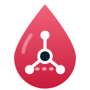

# Blood Supply

**АС распределения компонентов донорской крови между клиниками: запас против норматива, потребность районов, план пополнения по прогнозу ЧС, заявки врачей и реестр дефицита.**

**Система не ждёт, когда кровь закончится, а заранее распределяет её туда, где она понадобится.**

[Интерфейс](#интерфейс) · [Возможности](#возможности) · [Архитектура](#архитектура) · [Быстрый старт](#быстрый-старт) · [Демо за 5 минут](#демо-за-5-минут) · [Документация](#документация) · [План](docs/PLAN.md)

<br />

[](https://github.com/AlchemistBro/blood-supply-pet/actions/workflows/ci.yml)
[](https://go.dev/)
[](https://www.postgresql.org/)
[](https://kafka.apache.org/)
[](https://www.keycloak.org/)
[](https://htmx.org/)
[](https://kubernetes.io/)
[](LICENSE)

</div>

---

> **Статус на 25.10.2026: основные сценарии реализованы, локальная приёмка пройдена.**
> Обычные тесты: 1775 тестов/подтестов; с PostgreSQL: 1839, ещё 15 проверок Kafka пропущены.
> Пройдены сборка, линтеры и проверка безопасности исходников. Стенд на Docker Compose проверен вручную 25.10.2026
> ([аудит](docs/architecture/code-audit-2026-10-25.md), [руководство пользователя](docs/user-guide.md)); сквозной прогон в kind,
> нагрузка и восстановление не запускались: [результаты](docs/perf/acceptance-status.md),
> [безопасность](docs/architecture/security-local-2026-10-24.md).
> Данные, нормативы и правила подбора синтетические. Клиническое решение всегда принимает врач.

## О проекте

Запасы компонентов крови распределены по клиникам неравномерно. При чрезвычайной ситуации потребность резко растёт в
конкретных районах, а перераспределение между клиниками идёт вручную, по звонкам. Эта система держит запас каждой клиники
не ниже норматива, заранее пополняет его по агрегированному прогнозу ЧС и подбирает компонент по заявке врача по правилам,
не опуская клинику-источник ниже её защищённого объёма.

Назначение системы — учёт и распределение запаса, планирование и организация передачи между клиниками. Клиническое
решение и индивидуальную совместимость определяет врач: система предлагает варианты по демонстрационным правилам и
объясняет их, но не выбирает за врача и медицинским изделием не задумана. Границы регулирования —
[ADR-0024](docs/adr/0024-regulatory-boundaries.md), применимые акты и обязательства — [регуляторный реестр](docs/compliance/register.md).

Проект вырос из учебного архитектурного проекта (РТУ МИРЭА, дисциплины «Архитектура микросервисов» и DDD): предметная
модель, каталог из 52 функциональных и 17 нефункциональных требований, карта контекстов и сага подтверждения перенесены
как канон, а реализация сделана на Go как production-ready набор микросервисов с Kubernetes.

## Интерфейс

Веб-интерфейс на серверных шаблонах и HTMX, без фреймворков и встроенных скриптов (CSP без `unsafe-inline`). Тёмная боковая
панель, плотные таблицы, статусы бейджами, все подписи на русском. Скриншоты сняты со стенда с синтетическими данными.

| | |
| --- | --- |
| 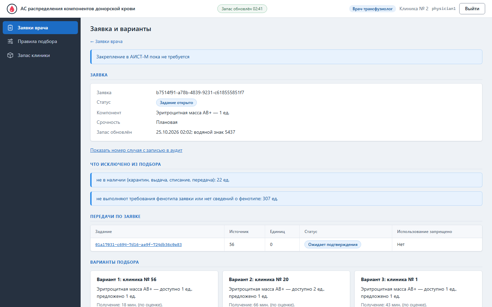 | 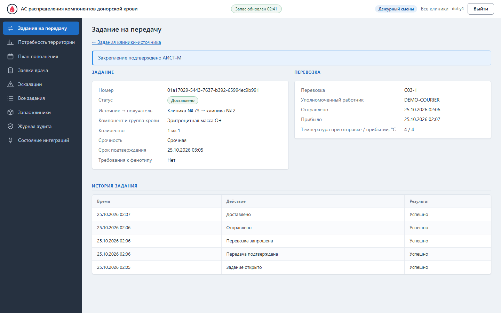 |
| **Заявка врача:** варианты подбора с объяснением | **Задание на передачу:** статус, перевозка, история |
| 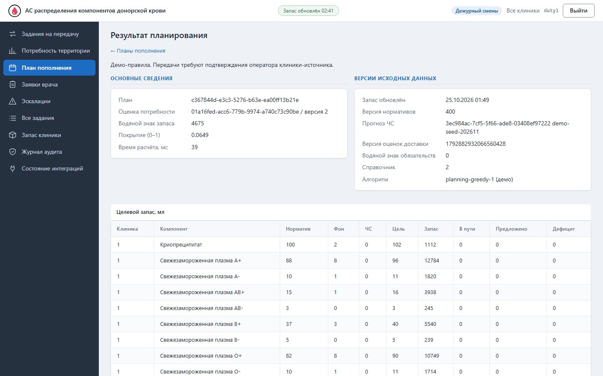 | 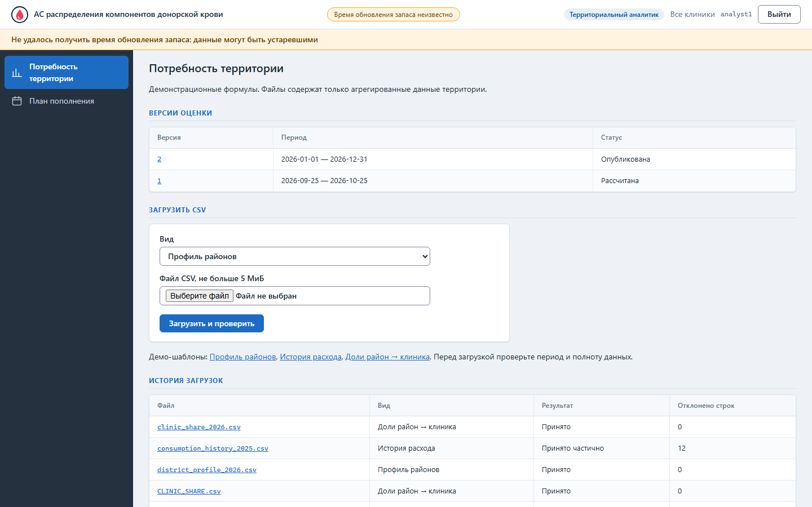 |
| **План пополнения** по прогнозу ЧС | **Потребность территории:** версии оценки и загрузка CSV |
| 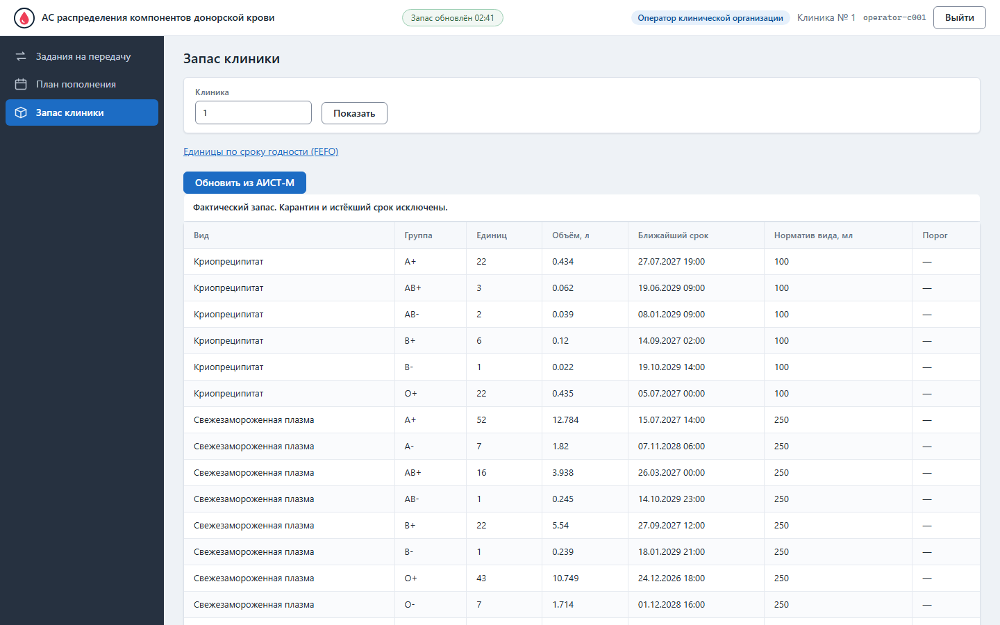 | 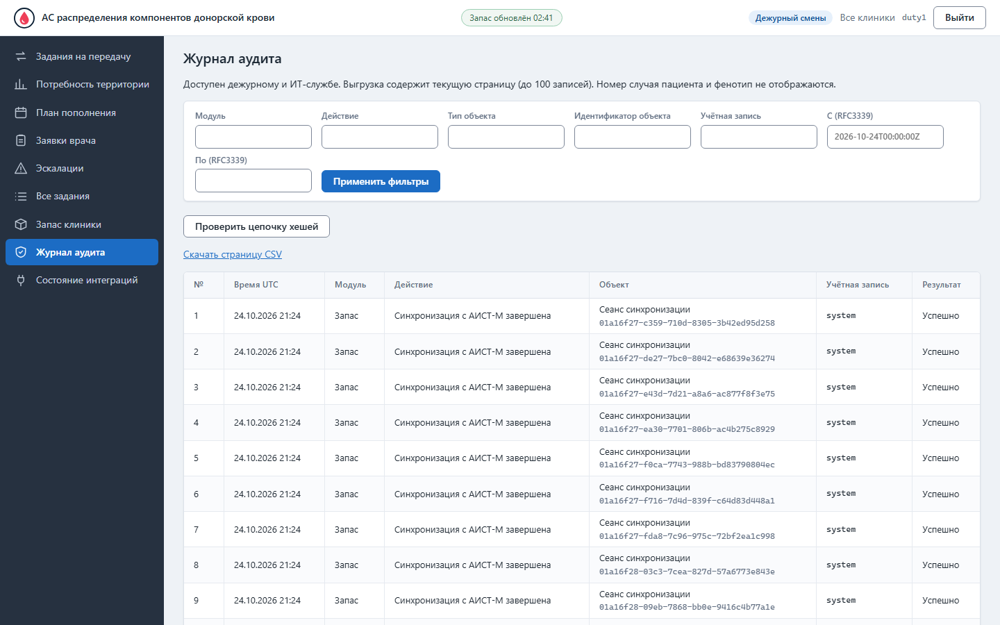 |
| **Запас клиники** против норматива | **Журнал аудита** с проверкой цепочки хешей |

## Возможности

| | |
| --- | --- |
| **Копия учёта АИСТ-М** | Изменения каждые несколько минут, суточный снимок CSV для сверки, внеочередное обновление оператором; на каждом экране видно, насколько свежи данные |
| **Запас и норматив** | Фактический запас по клинике, виду и группе AB0/Rh; норматив `Kгод/360`, минимум одна единица; подсветка «ниже норматива»; FEFO |
| **Территориальная потребность** | Аналитик загружает CSV (профили районов, история расхода, доли район → клиника); файл проверяется построчно; оценка рассчитывается по истории расхода и долям групп района и публикуется версиями |
| **План по прогнозу ЧС** | Агрегированный прогноз без персональных данных → целевой запас = норматив + фон + доля ЧС → подбор источников, которые никогда не опускаются ниже защищённого объёма → предложения операторам → реестр дефицита |
| **Заявка врача** | Номер случая K1 зашифрован; отдельное чтение с обязательным аудитом. Ограничения, варианты по версиям правил с объяснением, выбор врача → задание оператору источника; закрепление в АИСТ-М через постоянную очередь |
| **Сага подтверждения** | Оператор подтверждает единицы: точечная проверка в АИСТ-М, одна транзакция с закреплением (одна единица — одно обязательство, гарантирует уникальный индекс), заказ перевозки через outbox, компенсации при выбытии единицы, замена равноценной, долговечный таймер срока с эскалацией |
| **Логистика без дублей** | Шлюз к перевозчику со сверкой вместо повтора и арендой строки: `kill -9` посреди заказа не создаёт второй машины |
| **Аудит и приватность** | Изменения и чтение номера случая фиксируются в журнале с цепочкой хешей; K1 зашифрован, ФИО и СНИЛС не хранятся. Детектор подозрений на инцидент, фильтры, CSV и проверка цепочки |
| **Интерфейс гос-системы** | Серверный рендеринг на Go + HTMX, вход через OpenID Connect (Keycloak), экраны врача, оператора, аналитика, дежурного; работает без JavaScript |
| **Эксплуатация** | PostgreSQL на сервис, Kafka, OpenTelemetry, Grafana; Kubernetes с CloudNativePG (реплика, PITR), NetworkPolicy по сегментам, учение восстановления |

## Архитектура

Микросервисы по ограниченным контекстам DDD. Между сервисами только события и команды через Kafka (transactional outbox → inbox);
единственный синхронный вызов — проверка статуса единиц перед закреплением. У каждого сервиса своя база.

### C4 · уровень 1: контекст

[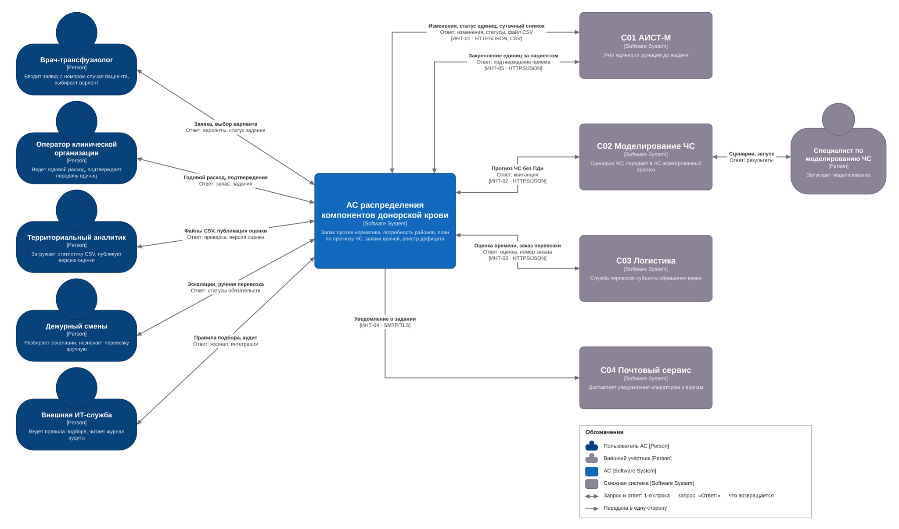](docs/architecture/diagrams/c4/c4-context.drawio.svg)

### C4 · уровень 2: контейнеры

[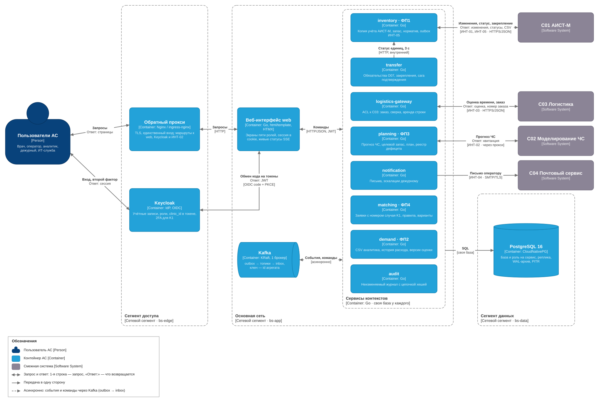](docs/architecture/diagrams/c4/c4-containers.drawio.svg)

### C4 · развёртывание в Kubernetes

[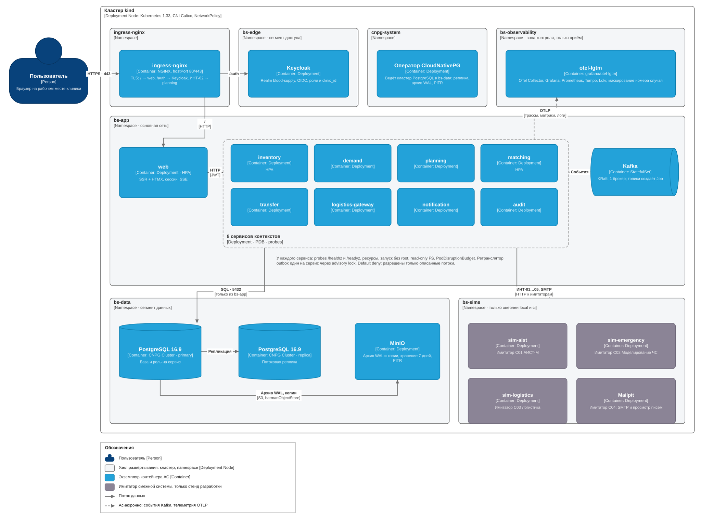](docs/architecture/diagrams/c4/c4-deployment.drawio.svg)

### UML · от заявки врача до заказа перевозки

Врач клиники C002 выбирает вариант из C001, оператор C001 подтверждает единицы, система заказывает перевозку
и закрепляет единицы за пациентом в АИСТ-М. Номер случая нигде не передаётся открытым текстом.

[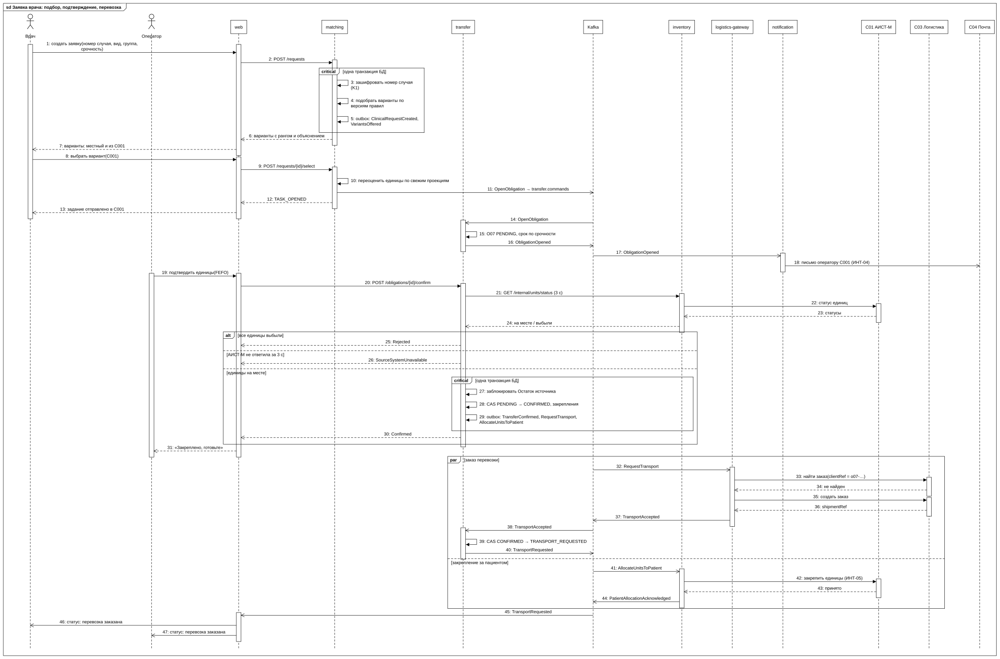](docs/architecture/diagrams/uml/sequence-request-to-transport.svg)

Компенсации при выбытии единицы, долговечный таймер срока и поведение при сбоях — в [описании саги](docs/architecture/saga-confirmation.md).
Схемы открываются в полном размере по щелчку; файлы `.drawio.svg` редактируются в draw.io,
исходник и перегенерация — `task docs:c4` ([как устроено](docs/architecture/diagrams/README.md#c4-и-uml-для-readme)).

### Схемы подробно

| Вид | Схемы |
| --- | --- |
| C4 | [контекст](docs/architecture/c4-context.md) · [контейнеры](docs/architecture/c4-containers.md) · [компоненты transfer и шлюза](docs/architecture/c4-components.md) |
| DDD | [карта контекстов](docs/domain/context-map.md) · [состояния O07](docs/domain/obligation-states.md) |
| UML | [сага и компенсации](docs/architecture/saga-confirmation.md) · [состояния и сверка шлюза](docs/architecture/uml.md) |
| BPMN 2.0 | [подтверждение передачи](docs/architecture/diagrams/bpmn/confirm-transfer.bpmn) · [план пополнения](docs/architecture/diagrams/bpmn/replenishment-plan.bpmn) · [заявка врача](docs/architecture/diagrams/bpmn/clinical-request.bpmn) · [загрузка CSV](docs/architecture/diagrams/bpmn/csv-demand.bpmn) · [процесс AS IS и TO BE](docs/architecture/diagrams/bpmn/as-is-to-be/README.md) |
| Данные и платформа | [события и команды](docs/architecture/events.md) · [модель данных](docs/architecture/data-model.md) · [развёртывание](docs/architecture/deployment.md) · [ADR](docs/adr/README.md) |

Полный перечень и способы открыть — [docs/architecture/diagrams](docs/architecture/diagrams/README.md).

### Стек

**Сервисы:** Go 1.27, `net/http`, OpenAPI + oapi-codegen, pgx + sqlc, goose, franz-go, slog + OpenTelemetry.
**Интерфейс:** `html/template`, HTMX 2, собственный CSS, SSE.
**Платформа:** PostgreSQL 16, Apache Kafka (KRaft), Keycloak, OTel Collector + grafana/otel-lgtm, Mailpit, Nginx.
**Kubernetes:** kind, kustomize, CloudNativePG, ingress-nginx, NetworkPolicy.
**Качество:** testcontainers-go, фитнес-тесты гонок, контрактные тесты JSON Schema, k6, хаос-сценарии, govulncheck, trivy, gitleaks, cosign + SBOM.

## Быстрый старт

Нужны Docker, Go 1.27.3+ и [go-task](https://taskfile.dev). На Windows команды выполняются из Git Bash.
Ниже — подготовленная инструкция для отдельного локального стенда; запуск compose и демо пока не проверен.
На рабочей машине с нестабильной сетью эти команды в рамках текущей приёмки не выполняются.

### 1. Клонировать

```bash
git clone https://github.com/AlchemistBro/blood-supply-pet.git
cd blood-supply-pet
```

### 2. Поднять стенд

```bash
task up        # PostgreSQL, Kafka, Keycloak, Grafana, Mailpit, все сервисы и имитаторы
task seed      # 10 000 единиц, нормативы, три CSV, прогноз, план и демо-заявка через HTTP
```

### 3. Открыть

| Что | Адрес |
| --- | --- |
| Интерфейс | https://localhost |
| Keycloak | http://localhost:8180 (`admin` / `admin`) |
| Grafana | http://localhost:3000 |
| Почта (Mailpit) | http://localhost:8025 |
| Kafka UI (необязательно) | http://localhost:8090; отдельный профиль `ui`, см. [сценарий демонстрации](docs/demo.md#подготовка) |

Демо-учётные записи (пароль `demo`): `physician1`, `operator-c001`, `operator-c002`, `analyst1`, `duty1`, `it1`.

### Разработка

```bash
task dev:transfer         # один сервис локально против платформы из compose
task test                 # обычные тесты; -race дополнительно при наличии gcc
task test:integration     # на реальных PostgreSQL и Kafka (testcontainers)
task test:fitness         # проверки Fitness/Race/Saga с тегом integration
task test:e2e             # сквозные сценарии против поднятого стенда
task ci                   # всё, что делает GitHub Actions
task k8s:up               # kind + kustomize overlay local
```

## Демо за 5 минут

Подробный [сценарий демонстрации](docs/demo.md) содержит подготовку, адреса экранов,
ожидаемые результаты и действия при отсутствии допустимого варианта. Пять минут — время показа
на заранее подготовленном стенде; установка, загрузки образов и наполнение в него не входят.

1. `analyst1`: `/demand` — входные CSV и опубликованная оценка; `/plans` — предложения и дефициты.
2. `physician1` (**клиника C002**): `/requests` — демо-заявка. Выберите **удалённый** вариант из C001,
   если он предложен. Вариант из C002 местный и не демонстрирует межклиническую перевозку.
3. `operator-c001`: задание источника C001, допустимые единицы FEFO, подтверждение и отправка.
   Если источник другой, работает `duty1`; выбор источника определяется фактическими вариантами.
4. `operator-c002`: приёмка в клинике-получателе C002; для полного обзора используйте `duty1`.
5. `it1`: `/audit` и `/integrations`; письмо оператору — в Mailpit. Номер случая открывается отдельно
   с записью чтения в аудит. Дополнительный пример нарушения условий описан в сценарии.

`task seed` не выбирает варианты и не подтверждает передачи. Повторное наполнение не возвращает уже
изменённые заявки и задания в начальное состояние. Команды нагрузки, хаоса, Kubernetes и восстановления
описаны отдельно и для обычного показа не нужны. Сквозной показ на работающем стенде ещё не подтверждён.

## Что показывает проект архитектурно

- Ограниченные контексты и карта контекстов, перенесённые в физические границы сервисов и баз.
- Сага с оркестратором, компенсациями, долговечным таймером и четырьмя задокументированными гонками, покрытыми тестами.
- Transactional outbox, inbox, идемпотентность по ключу, упорядоченность по ключу агрегата, сверка вместо повтора, аренда строки.
- Проекции с водяным знаком вместо распределённых JOIN; честная деградация при задержке.
- Приватность по умолчанию: белый список прогноза, шифрование K1, отдельное чтение с обязательным аудитом и запрет открытого номера случая в событиях и логах.
- Схемы C4, UML (sequence, state, class, deployment), BPMN 2.0, ER в репозитории и сверенные с кодом.
- Kubernetes с продовыми практиками: оператор PostgreSQL с PITR, NetworkPolicy по сегментам, probes, HPA, учение восстановления.

## Документация

| Раздел | Где |
| --- | --- |
| Сценарий показа, роли, ожидаемые результаты | [docs/demo.md](docs/demo.md) |
| Фактическая приёмка и оставшиеся проверки | [docs/perf/acceptance-status.md](docs/perf/acceptance-status.md) |
| Приёмка v1.0.0 и проверка образов | [результаты](docs/perf/release-v1.0.0-2026-10-26.md), [релиз](docs/release.md) |
| План, решения, этапы, статус | [docs/PLAN.md](docs/PLAN.md) |
| Правила разработки | [CONTRIBUTING.md](CONTRIBUTING.md) |
| Канон предметной области: глоссарий, требования, состояния O07, карта контекстов | [docs/domain/](docs/domain/) |
| Архитектура: C4, события, модель данных, сага, развёртывание, безопасность, тесты | [docs/architecture/](docs/architecture/) |
| Решения (ADR) | [docs/adr/](docs/adr/README.md); этап 1: [отступления от канона и прототипа](docs/adr/0027-stage1-deviations.md), [границы регулирования](docs/adr/0024-regulatory-boundaries.md), [перевозка](docs/adr/0022-transport-carrier-and-conditions.md) |
| Регуляторный реестр: акты, статусы, обязательства | [docs/compliance/register.md](docs/compliance/register.md) |
| Задачи по этапам | [docs/tasks/](docs/tasks/) |
| Стиль и экраны интерфейса | [docs/ui/](docs/ui/) |

## Структура проекта

```
libs/         contracts · messaging · httpx · observability · pgx · clock · refdata · testdata
services/     web · inventory · demand · planning · matching · transfer · logistics-gateway · notification · audit · sim-*
deploy/       compose · docker · k8s (base, overlays)
tests/        e2e · load · chaos
docs/         PLAN · domain · architecture · adr · compliance · tasks · ui
```

## Состояние проекта

Этапы 0–9 с критериями выхода описаны в [docs/PLAN.md](docs/PLAN.md#4-этапы). Английское описание — в [README.en.md](README.en.md).
CI с PostgreSQL/Kafka, десять Compose E2E-сценариев, нагрузка 50 пользователей и сканирование
образов приложения прошли. В Kubernetes проверены отказы, реальное оповещение Grafana,
PITR с работой приложения на восстановленной копии и холодный запуск готовых образов менее чем за 10 минут.
[Релиз v1.0.0 опубликован](https://github.com/AlchemistBro/blood-supply-pet/releases/tag/v1.0.0):
13 образов с сохранёнными digest, подписями, SBOM и provenance; 73 файла подтверждений приложены к выпуску.
Полный ручной показ и дополнительные пункты наблюдаемости перечислены в этапах 8–9.
Внешний хостинг исключён из объёма.

## Вклад в проект

Это личный пет-проект, но замечания и вопросы по архитектуре приветствуются через Issues. Перед PR: `task ci`.
Рекомендуемый процесс публикации — PR с зелёным CI. Настройка защиты `main` остаётся задачей владельца.

## Лицензия

MIT
