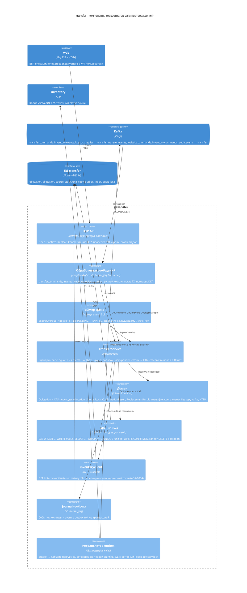
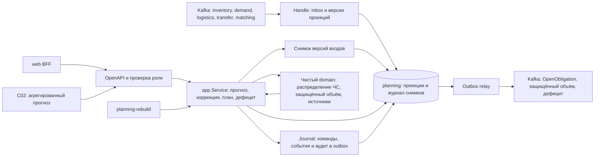
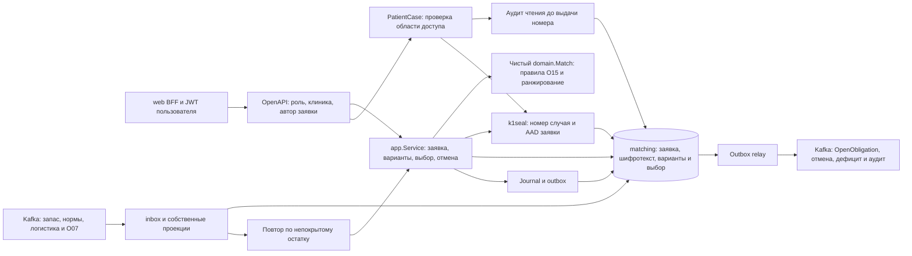
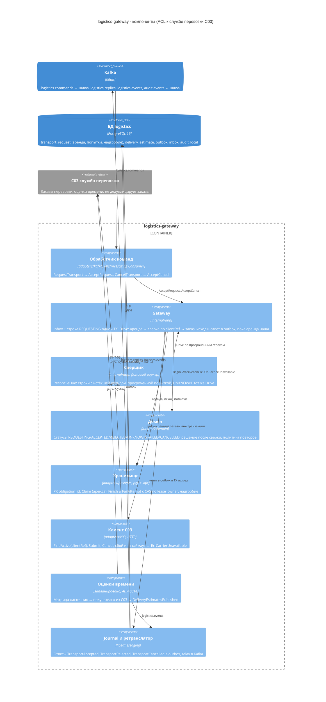

# C4 · Уровень 3: компоненты `transfer` и `logistics-gateway`

Два сервиса, на которых держится сага подтверждения. Компоненты соответствуют пакетам сервиса
([repo-layout.md](repo-layout.md), раздел «Анатомия сервиса»): зависимости направлены внутрь,
`adapters → app → domain`; общие механизмы — платформенные библиотеки `libs/`. Поведение — [сага](saga-confirmation.md),
[состояния O07](../domain/obligation-states.md), BPMN [confirm-transfer.bpmn](diagrams/bpmn/confirm-transfer.bpmn).

## transfer

| Компонент | Пакет | Отвечает за | Требования, ADR |
| --- | --- | --- | --- |
| HTTP API | `internal/api`, `internal/adapters/http` | Контракт `api/openapi.yaml`; роль и клиника из токена; ответ подтверждения в том же запросе | FR028, FR043, FR048, NFR011, ADR-0015 |
| Обработчики сообщений | `internal/adapters/kafka` | Inbox в транзакции обработчика; `OpenObligation`, `CancelObligation`; проекция `unit_copy` и компенсации; ответы шлюза | ADR-0003, ADR-0027 |
| Таймер срока | `internal/app` (воркер) | Частичный индекс `(deadline) WHERE status = 'PENDING'`; новое O07 с `choice_id = uuid v5` | FR049, ADR-0027 |
| TransferService | `internal/app` | `Open`, `Confirm`, `Replace`, `Cancel`, `ExpireOverdue`, `OnUnitEvent`, `OnLogisticsReply`; порты `Store`, `UnitStatusChecker` | FR048, FR049, NFR004, NFR013 |
| Домен | `internal/domain` | Статусы и переходы O07, результаты подтверждения и замены, спецификация замены | `obligation-states.md`, ADR-0011 |
| Хранилище | `internal/adapters/postgres` | Таблицы `obligation`, `allocation`, `source_stock`, `unit_copy` | NFR004, ПП РФ № 641 п. 17–18 |
| inventoryclient | `internal/adapters/inventoryclient` | Единственный синхронный межсервисный вызов; `SourceSystemUnavailable` при сбое | ADR-0004, ADR-0027 |
| Journal, ретранслятор | `libs/messaging` | Transactional outbox, порядок по ключу `obligation_id` | ADR-0003 |

## planning

Расчёт сохраняет входы и результат одной транзакцией. Фон приводится к периоду прогноза (ADR-0029),
защищённые пороги включаются в команду (ADR-0028). Пересчёт отменяет только прежние PENDING через
надгробие запроса (ADR-0030). Восстановление проекций использует локальные снимки и не повторяет задания (ADR-0034).

## matching

Варианты не содержат номера случая или фенотипа. Номер открывается отдельной операцией только автору-врачу
или оператору источника активной подтверждённой передачи; отказ аудита закрывает выдачу (ADR-0020).
ИНТ-05 выполняет inventory через постоянную очередь; matching читает квитанции, не вызывает его HTTP (ADR-0031).

## logistics-gateway

| Компонент | Отвечает за | Почему так |
| --- | --- | --- |
| Gateway | Ровно один заказ у C03 на обязательство | Перевозчик не дедуплицирует: повтор вслепую после потерянного ответа создал бы вторую машину. Сверка по `clientRef` всегда раньше отправки |
| Аренда строки (`lease_owner`, `lease_until`, 30 с) | С C03 по строке говорит один экземпляр | `kill -9` посреди заказа: аренда истекает, сверщик продолжает; несколько экземпляров шлюза не создают второй заказ |
| CAS по `lease_owner` при записи исхода | Исход опоздавшего владельца отбрасывается | Ответ transfer уходит только от того, кто держал аренду |
| `UNKNOWN` и `FAILED` | Честное «не знаем» после `max-attempts` (5) | transfer получает `TransportRejected(OUTCOME_UNKNOWN)` и эскалирует дежурному; сверка продолжается, найденный заказ даёт запоздалый `TransportAccepted`, не найденный — `FAILED` без повторной отправки |
| Надгробие | `CancelTransport` обогнал `RequestTransport` | Строка `CANCELLED` без маршрута; поздняя команда упирается в первичный ключ, заказа нет |
| Оценки времени | Расчёт плана и подбор без синхронных вызовов | ADR-0014; реализация вне этапа 1 |

Состояния строки `transport_request` — [uml.md](uml.md#состояния-заказа-перевозки-transport_request),
сверка при потерянном ответе — [uml.md](uml.md#сверка-шлюза-при-потерянном-ответе-c03).
