# C4 · Уровень 2: контейнеры

```mermaid
C4Container
    title АС распределения компонентов донорской крови · контейнеры (целевая, микросервисы)

    Person(physician, "Врач-трансфузиолог")
    Person(operator, "Оператор клинической организации")
    Person(analyst, "Территориальный аналитик")
    Person(duty, "Дежурный смены")
    Person(it, "Внешняя ИТ-служба")

    System_Boundary(as, "АС распределения компонентов донорской крови") {
        Container(proxy, "Обратный прокси", "Nginx / ingress-nginx", "TLS, единственный вход, лимиты")
        Container(keycloak, "Keycloak", "IdP, OIDC", "Учётные записи, роли, clinic_id в токене, 2FA для K1")
        Container(web, "web", "Go, html/template, HTMX", "BFF и интерфейс пяти ролей; сессия в cookie; SSE")

        Container(inventory, "inventory", "Go", "ФП1: копия учёта АИСТ-М (ACL), запас, норматив, водяной знак, outbox ИНТ-05")
        Container(demand, "demand", "Go", "ФП2: CSV, история расхода, доли, версии оценки")
        Container(planning, "planning", "Go", "ФП3: прогноз ЧС, целевой запас, план, реестр дефицита")
        Container(matching, "matching", "Go", "ФП4: заявка K1, правила O15, варианты, выбор")
        Container(transfer, "transfer", "Go", "O07, закрепления O18, Остаток источника, сага подтверждения")
        Container(logistics, "logistics-gateway", "Go", "ACL к C03: заказ, сверка, аренда, оценки времени")
        Container(notification, "notification", "Go", "Письма, эскалации дежурному")
        Container(audit, "audit", "Go", "Неизменяемый журнал, цепочка хешей")

        ContainerQueue(kafka, "Kafka", "KRaft, 1 брокер", "outbox → топики → inbox; ключ = id агрегата; JSON Schema в CI")
        ContainerDb(pg, "PostgreSQL 16", "CloudNativePG в k8s", "База и роль на сервис: inventory, demand, planning, matching, transfer, logistics, notification, audit")
        Container(otel, "Наблюдаемость", "OTel Collector + grafana/otel-lgtm", "Трассы, метрики, логи; correlation id; маскирование")
    }

    System_Ext(c01, "C01 АИСТ-М")
    System_Ext(c02, "C02 Моделирование ЧС")
    System_Ext(c03, "C03 Логистика", "Служба перевозки (ADR-0022)")
    System_Ext(c04, "C04 Почта")

    Rel(physician, proxy, "HTTPS")
    Rel(operator, proxy, "HTTPS")
    Rel(analyst, proxy, "HTTPS")
    Rel(duty, proxy, "HTTPS")
    Rel(it, proxy, "HTTPS")
    Rel(proxy, web, "HTTP")
    Rel(web, keycloak, "OIDC code + PKCE")
    Rel(web, inventory, "HTTP/JSON, JWT")
    Rel(web, demand, "HTTP/JSON, JWT")
    Rel(web, planning, "HTTP/JSON, JWT")
    Rel(web, matching, "HTTP/JSON, JWT")
    Rel(web, transfer, "HTTP/JSON, JWT")
    Rel(web, audit, "POST /records, чтение журнала", "служебный токен, ADR-0017")
    Rel(transfer, inventory, "GET /internal/units/status · 3 с · предохранитель", "единственный синхронный вызов")
    Rel(inventory, kafka, "события")
    Rel(demand, kafka, "события")
    Rel(planning, kafka, "события, команды transfer")
    Rel(matching, kafka, "события, команды transfer")
    Rel(transfer, kafka, "события, команды logistics и inventory")
    Rel(logistics, kafka, "ответы, оценки времени")
    Rel(kafka, notification, "transfer.events, planning.events")
    Rel(kafka, audit, "audit.events")
    Rel(inventory, c01, "ИНТ-01, ИНТ-05")
    Rel(c02, planning, "ИНТ-02 (через прокси)")
    Rel(logistics, c03, "ИНТ-03")
    Rel(notification, c04, "ИНТ-04 SMTP")
```

## Контейнеры и их обязанности

| Контейнер | Входы | Выходы | Хранит |
| --- | --- | --- | --- |
| `web` | HTTPS от пользователей, SSE-подписка на статусы (внутренний consumer `transfer.events` только для push) | HTTP к сервисам с JWT пользователя; записи аудита в `audit` по `POST /records` (вход, отказ, чтение номера случая; ADR-0017) | сессии (зашифрованная cookie), кэш справочников |
| `inventory` | ИНТ-01 опрос C01 (расписание, FR050), команда `AllocateUnitsToPatient` от transfer, `GET /internal/units/status` | `inventory.events`, ИНТ-05 к C01 из outbox | единицы, история статусов, годовой расход, норматив, SyncRun, aist_outbox_message |
| `demand` | multipart CSV от аналитика, `ConsumptionExportPublished` от inventory | `demand.events` | файлы, профили, история, доли, версии оценки |
| `planning` | ИНТ-02 прогноз от C02, `inventory.events`, `demand.events`, `transfer.events`, `logistics.events`, `matching.events` (дефицит заявок) | `planning.events`, команды `OpenObligation`, `CancelObligation` | прогнозы, целевой запас, планы, предложения, реестр дефицита, проекции |
| `matching` | заявка врача, `inventory.events`, `transfer.events`, `logistics.events` | `matching.events`, команды `OpenObligation`, `CancelObligation` | заявки, ограничения, правила O15, варианты, выбор, проекции единиц и оценок времени |
| `transfer` | команды от matching/planning, подтверждение/замена от оператора, `inventory.events`, `logistics.replies` | `transfer.events`, `logistics.commands`, `inventory.commands` (ИНТ-05) | обязательства, закрепления, Остаток источника, копии единиц, outbox/inbox |
| `logistics-gateway` | `logistics.commands` | `logistics.replies`, `logistics.events` (оценки) | заказы перевозки с арендой и попытками, кэш оценок |
| `notification` | `transfer.events`, `planning.events` | SMTP к C04 | журнал отправок, шаблоны |
| `audit` | `audit.events` (от каждого сервиса), `POST /records` от `web` (ADR-0017) | HTTP чтение журнала (роли IT_SERVICE, DUTY_OFFICER), проверка цепочки | записи с `prev_hash`, `hash` |

Компоненты `transfer` и `logistics-gateway` — [c4-components.md](c4-components.md). Смежные системы C01–C04 на стенде
разработки заменены имитаторами `sim-aist`, `sim-emergency`, `sim-logistics` и Mailpit ([c4-context.md](c4-context.md));
это не контейнеры АС: у них нет базы (`Spec.NoDB`, ADR-0015), в Kubernetes они разворачиваются только оверлеями `local` и `ci`.

## Что отличается от учебных схем v12 и почему

| Учебная схема (ПР6, монолит) | Здесь | ADR |
| --- | --- | --- |
| Модульный монолит Java 21 / Spring Modulith | 8 Go-сервисов + web | ADR-0001, ADR-0002 |
| Одна БД, схема на модуль | Один экземпляр PostgreSQL, база и роль на сервис | ADR-0005 |
| Внутренние вызовы между модулями | Kafka события/команды; один синхронный вызов | ADR-0003, ADR-0004 |
| Spring Security, собственные учётные записи (схема access) | Keycloak, OIDC | ADR-0006 |
| React + TypeScript | Go SSR + HTMX | ADR-0007 |
| Закрепление единиц в ФП3 (planning) | Контекст transfer (выделен из ФП3 по карте миграции) | ADR-0002 |
| Patroni + pgBackRest | CloudNativePG (реплика, WAL-архив, PITR) | ADR-0009 |
