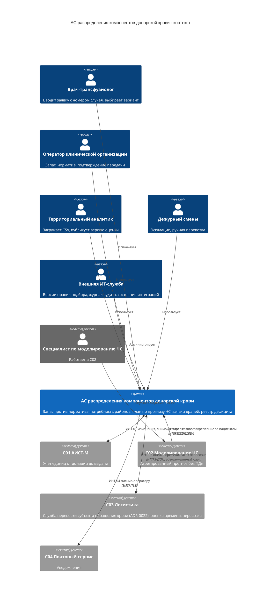

# C4 · Уровень 1: контекст системы

## Границы

Внутри АС: копия учёта единиц, норматив, фоновая потребность, план пополнения, обязательства и закрепления,
заявки врачей и подбор, реестр дефицита, аудит.

Снаружи: первичный учёт единиц (C01), сценарии ЧС и состав пострадавших (C02, FR036–FR042), перевозка (C03:
по ADR-0022 — служба перевозки субъекта обращения крови, а не сторонний перевозчик), доставка писем (C04),
учётные записи (Keycloak как часть платформы АС).

На стенде разработки смежные системы заменены имитаторами; в состав АС они не входят:

| Система | Имитатор | Порт |
| --- | --- | --- |
| C01 АИСТ-М | `sim-aist`: единицы и статусы, изменения, суточный снимок CSV, приём закреплений (ИНТ-05), инъекция сбоев | 8201 |
| C02 Моделирование ЧС | `sim-emergency`: отправка агрегированного прогноза, в том числе «с ПДн» для проверки белого списка | 8202 |
| C03 Логистика | `sim-logistics`: оценки времени, заказы перевозки без дедупликации (нарочно), сбои | 8203 |
| C04 Почтовый сервис | Mailpit: SMTP и веб-просмотр писем | 1025 / 8025 |

Уровни C4 ниже: [контейнеры](c4-containers.md), [компоненты transfer и logistics-gateway](c4-components.md).

АС не выдаёт кровь физически, не перевозит, не назначает лечение, не определяет индивидуальную совместимость и не
идентифицирует пациентов: она применяет заданные правила к подтверждённым характеристикам заявки.
