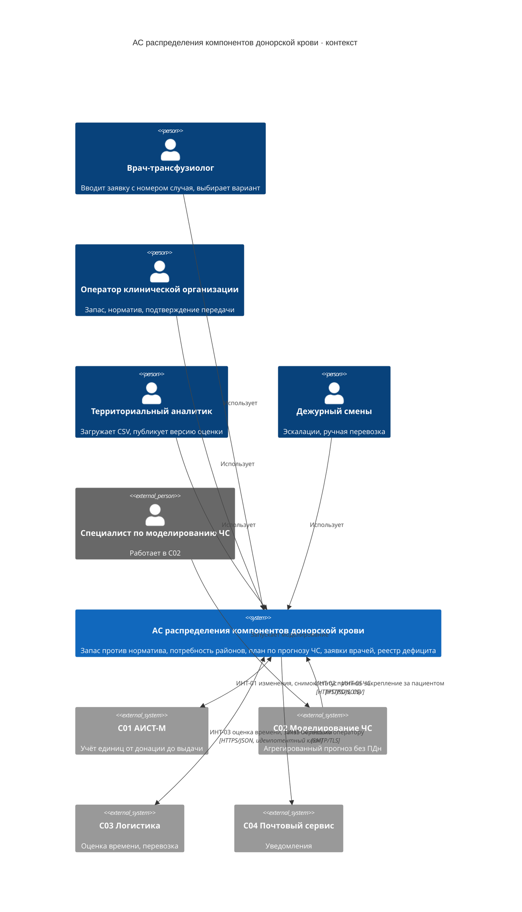

# C4 · Уровень 1: контекст системы

## Границы

Внутри АС: копия учёта единиц, норматив, фоновая потребность, план пополнения, обязательства и закрепления,
заявки врачей и подбор, реестр дефицита, аудит.

Снаружи: первичный учёт единиц (C01), сценарии ЧС и состав пострадавших (C02, FR036–FR042), перевозка (C03),
доставка писем (C04), учётные записи (Keycloak как часть платформы АС).

АС не выдаёт кровь физически, не перевозит, не назначает лечение, не определяет индивидуальную совместимость и не
идентифицирует пациентов: она применяет заданные правила к подтверждённым характеристикам заявки.
