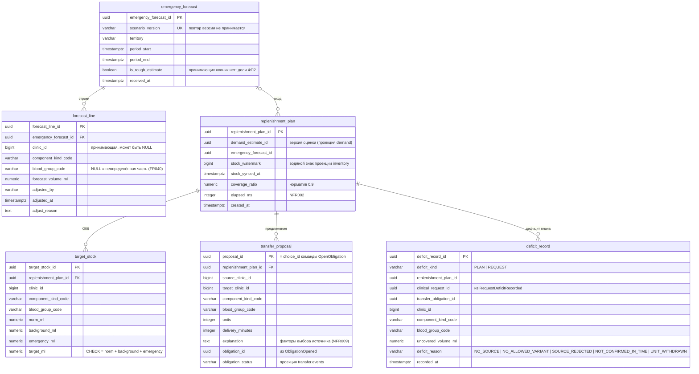

# Модель данных: база на сервис

Источник: словарь данных ПР6 АМ (44 таблицы, 7 схем). Здесь схемы разнесены по базам сервисов, имена приведены к
snake_case, суррогатные ключи агрегатов — `uuid` v7, справочники — естественные коды. Имена сущностей и полей
совпадают со словарём ПР6, чтобы трассировка к учебным документам сохранялась.

Общие правила:

- Один экземпляр PostgreSQL 16, база и роль на сервис (`inventory`, `demand`, `planning`, `matching`, `transfer`, `logistics`, `notification`, `audit`), `REVOKE CONNECT … FROM PUBLIC`.
- Миграции `goose` в `services/<svc>/migrations/*.sql`, встроены в бинарник, применяются при старте с advisory lock.
- В каждой базе платформенные таблицы `outbox`, `inbox` (см. `events.md`) и `audit_local` (локальная запись в транзакции, уходит в `audit.events` через outbox).
- Справочники `ref_*` (клиники, районы, виды, группы, срочность) во всех базах одинаковые, заполняются из `libs/refdata` миграцией-сидом.
- Внешних ключей между базами нет; ссылки на чужие агрегаты — `uuid` без FK, целостность через проекции с версией.
- Объёмы в мл — `bigint`, расчётные доли и объёмы — `numeric`, время — `timestamptz`.

## inventory

```mermaid
erDiagram
    ref_clinic ||--o{ unit : хранит
    unit ||--o{ unit_status_history : история
    ref_component_kind ||--o{ unit : вид
    ref_blood_group ||--o{ unit : группа
    unit_status_dict ||--o{ unit : статус
    ref_clinic ||--o{ annual_consumption : "Kгод"
    annual_consumption ||--o{ stock_norm : рассчитан
    sync_run }o--|| ref_clinic : "по клинике (опц.)"
    aist_outbox_message }o--o{ unit : "закрепление за пациентом"

    unit {
        uuid unit_id PK
        varchar aist_unit_code UK "исходный id в АИСТ-М, наружу не публикуется"
        bigint clinic_id FK
        varchar storage_location
        varchar component_kind_code FK
        bigint volume_ml
        varchar blood_group_code FK
        varchar phenotype
        timestamptz expires_at
        varchar unit_status_code FK
        timestamptz status_received_at
        bigint source_version "старая версия не перезаписывает новую"
    }
    unit_status_history {
        uuid unit_status_history_id PK
        uuid unit_id FK
        varchar unit_status_code FK
        bigint source_version "UNIQUE(unit_id, source_version)"
        timestamptz changed_at
        timestamptz received_at
    }
    annual_consumption {
        uuid annual_consumption_id PK
        bigint clinic_id FK
        varchar component_kind_code FK
        smallint consumption_year
        bigint annual_volume_ml
        varchar entered_by "user id из токена"
        timestamptz entered_at
    }
    stock_norm {
        uuid stock_norm_id PK
        uuid annual_consumption_id FK
        bigint clinic_id FK
        varchar component_kind_code FK
        numeric avg_monthly_ml "Kгод/12"
        numeric norm_ml "Kгод/360, не меньше одной единицы"
        boolean is_min_unit_applied
        boolean is_current "UNIQUE(clinic, kind) WHERE is_current"
        timestamptz calculated_at
    }
    sync_run {
        uuid sync_run_id PK
        varchar sync_kind "CHANGES | DAILY_SNAPSHOT | ON_DEMAND | UNIT_CHECK"
        varchar requested_by
        timestamptz started_at
        timestamptz finished_at "последнее успешное = водяной знак"
        varchar sync_result "SUCCESS | PARTIAL | FAILED"
        integer changes_count
        text error_text
    }
    aist_outbox_message {
        uuid aist_outbox_message_id PK
        uuid idempotency_key UK
        uuid transfer_obligation_id
        varchar message_type "ALLOCATE_TO_PATIENT | RELEASE_ALLOCATION"
        jsonb payload "id единиц, номер случая, клиника; без ФИО/СНИЛС"
        timestamptz created_at
        integer attempt_count
        timestamptz next_attempt_at
        timestamptz acknowledged_at
        text last_error
    }
```

Представление `actual_stock` (O02): `clinic_id, component_kind_code, blood_group_code, unit_count, volume_ml, nearest_expiry`
по единицам со статусом `is_available` и `expires_at > now()`. Индекс `(clinic_id, component_kind_code, blood_group_code, expires_at)`.

## demand

Таблицы по словарю ПР6 без изменений состава: `statistics_file` (с `file_checksum` SHA-256 UNIQUE), `file_row_error`,
`district_profile`, `district_group_share`, `consumption_history`, `clinic_share_version`, `clinic_share`,
`estimate_status_dict`, `demand_estimate`, `estimate_history_link`, `clinic_demand`.
Ключевые ограничения: `PUBLISHED` только с `confirmed_by` и `confirmed_at`; суммы долей по району равны 1 проверяются при загрузке;
`UNIQUE NULLS NOT DISTINCT (demand_estimate_id, clinic_id, component_kind_code, blood_group_code)`.

## planning

Проекции: `stock_projection` (из `StockSnapshotPublished` и `StockNormPublished`), `demand_projection` (из `DemandEstimatePublished`),
`delivery_estimate_projection` (из `DeliveryEstimatesPublished`), `obligation_projection` (из `transfer.events`).

## matching

Таблицы по словарю ПР6: `matching_rule` (O15, `UNIQUE(rule_code, version_no)`, `valid_from`, `valid_to`, `basis_document`, `basis_clause`),
`request_status_dict`, `clinical_request` (O09, `patient_case_no` K1), `request_constraint` (O08), `variant_offer` (O10, `UNIQUE(clinical_request_id, rank_no)`,
`explanation`, `stock_watermark`), `variant_offer_unit_link`, `variant_selection`.
Проекции: `unit_projection` (единицы в наличии по клиникам из `inventory.events`), `delivery_estimate_projection`, `obligation_projection`.
`patient_case_no` хранится в отдельной таблице `clinical_request_patient` с шифрованием на уровне колонки (`pgcrypto`, ключ из Secret)
и отдаётся отдельным эндпоинтом, каждое чтение которого пишет `READ_PATIENT_CASE` в аудит (NFR016).

## transfer

Перенос схемы Java-прототипа (`V1__transfer_core.sql`, `V2__messaging.sql`) с именами из ПР6:

| Таблица | Назначение | Ключевые ограничения |
| --- | --- | --- |
| `source_stock` | Остаток источника: `clinic_id, component_kind_code, available_units, reserved_units, protected_volume, protected_version, protected_reason` | PK (clinic, kind); блокируется `FOR UPDATE` первой |
| `unit_copy` | Проекция единиц из `inventory.events` с версией | `version` растёт только вперёд |
| `obligation` | O07: `obligation_id, choice_id UK, request_id, origin, source_clinic_id, target_clinic_id, component_kind_code, blood_group_code, requested_qty, confirmed_qty, status, urgency_code, deadline, confirm_window_seconds, fallback_sources text[], spec_* (группа, резус, фенотип, min_expires_at, rule_version), confirm_key, transport_ref, status_reason, version, created_at, updated_at` | `CHECK (source ≠ target)`; индекс `(deadline) WHERE status='PENDING'`; индекс `(request_id)` |
| `allocation` | O18: `allocation_id, unit_id, obligation_id, status (CONFIRMED/RELEASED/CONSUMED), created_at, closed_at` | `UNIQUE (unit_id) WHERE status = 'CONFIRMED'` — NFR004 |
| `outbox`, `inbox`, `audit_local` | платформа | см. `events.md` |

## logistics

`transport_request(obligation_id PK, request_id, source_clinic_id, target_clinic_id, component_kind_code, quantity, status REQUESTING/ACCEPTED/REJECTED/UNKNOWN/FAILED/CANCELLED, shipment_ref, cancel_requested, attempts, next_attempt_at, lease_owner, lease_until, last_error, created_at, updated_at)`
плюс `delivery_estimate(source_clinic_id, target_clinic_id, minutes, estimated_at)`, `outbox`, `inbox`.

## notification

`notification(notification_id PK, kind, recipient_user, recipient_email, subject, body_ref, obligation_id, status QUEUED/SENT/FAILED, attempts, sent_at)`, `inbox`.
Письмо не содержит спецификации замены и номера случая: только ссылка на задание, вид, объём, срочность (FR044).

## audit

`audit_record(audit_record_id PK, seq bigint UK, occurred_at, user_id, role, clinic_id, module, action, object_type, object_id, result, details jsonb, correlation_id, prev_hash bytea, hash bytea)`.
`hash = sha256(prev_hash || canonical_json(record))`; роль БД `audit_writer` имеет только INSERT; проверка цепочки — `task audit:verify` и эндпоинт `/internal/verify`.

## Соответствие словарю ПР6

| ПР6 (схема.Таблица) | Здесь |
| --- | --- |
| `ref.*` | `ref_*` во всех базах из `libs/refdata` |
| `access.*` | Keycloak realm `blood-supply` |
| `inventory.*`, `inventory.ActualStock`, `inventory.AistOutboxMessage` | база `inventory` |
| `demand.*` | база `demand` |
| `planning.EmergencyForecast, ForecastLine, ReplenishmentPlan, TargetStock, DeficitRecord` | база `planning` (+ `transfer_proposal`) |
| `planning.TransferObligation, UnitAllocation, ObligationStatusDict` | база `transfer`: `obligation`, `allocation` (контекст выделен, ADR-0002) |
| `requests.*` | база `matching` |
| `audit.AuditRecord` | база `audit` с цепочкой хешей |
