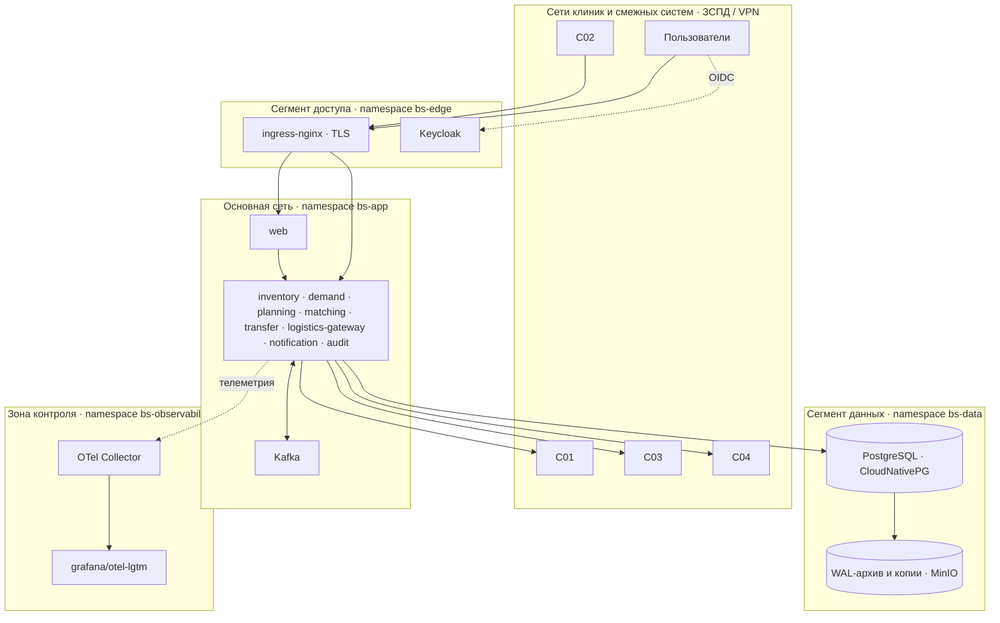

# Развёртывание: compose для разработки, Kubernetes как целевая среда

## Сетевые сегменты (из ПР4 АМ, перенесены в k8s как NetworkPolicy)



NetworkPolicy: `bs-data` принимает только из `bs-app`; `bs-observability` только принимает; `matching` (K1) имеет
отдельную политику — к его базе ходит только он. Поток F-06 (ИНТ-05, K1) в проде — mTLS, в демо — обычный HTTP к имитатору с пометкой.

## Docker Compose (`deploy/compose`)

| Файл | Содержимое |
| --- | --- |
| `compose.yaml` | postgres (init: базы и роли), kafka (KRaft), keycloak (realm import), otel-lgtm, mailpit, nginx; профили `services` (все Go-сервисы из образов), `sims` (имитаторы), `ui` (kafka-ui) |
| `compose.dev.yaml` | только платформа; сервисы запускаются локально через `task dev:<svc>` |
| `postgres/init.sql` | `CREATE ROLE/DATABASE` на каждый сервис, `REVOKE CONNECT FROM PUBLIC` |
| `keycloak/realm-blood-supply.json` | realm, клиент `web` (confidential, PKCE), роли, атрибут `clinic_id`, демо-пользователи: `physician1`, `operator-c001`, `operator-c002`, `analyst1`, `duty1`, `it1` (пароль `demo`) |
| `nginx/nginx.conf` | TLS с самоподписанным сертификатом, `/` → web, `/auth` → keycloak, `/api/int/forecast` → planning (ИНТ-02) |
| `otel/collector.yaml` | приём OTLP, маскирование атрибутов `patient_case_no`, экспорт в lgtm |

Порты: web 8080, keycloak 8180, kafka 9092, postgres 5432, grafana 3000, mailpit 8025, kafka-ui 8090, сервисы 8101–8108, имитаторы 8201–8203.

## Kubernetes (`deploy/k8s`)

```
deploy/k8s/
  base/
    namespaces.yaml
    platform/   kafka (StatefulSet, 1 брокер), keycloak (Deployment + realm ConfigMap), otel, mailpit
    data/       cnpg Cluster (instances: 2, backup → MinIO, retention 7d), ScheduledBackup, Database/Role на сервис
    services/   <svc>/deployment.yaml, service.yaml, hpa.yaml, pdb.yaml, networkpolicy.yaml, servicemonitor.yaml
    ingress/    ingress-nginx values, Ingress для web и ИНТ-02
    kustomization.yaml
  overlays/
    local/      kind: NodePort, самоподписанный TLS, демо-секреты (secretGenerator), имитаторы включены
    ci/         то же, минимальные ресурсы, e2e Job
    prod-example/  пример: реплики 2, ресурсы, внешний Secret-менеджер, без имитаторов (не разворачивается)
```

Стандарт сервиса в k8s: `readinessProbe /readyz` (БД и Kafka достижимы, миграции применены), `livenessProbe /healthz`,
`resources` заданы, `securityContext` без root и с read-only FS, `PodDisruptionBudget`, HPA по CPU для stateless
(web, inventory, matching), для `transfer`/`logistics-gateway` масштабирование допустимо (аренда и CAS это разрешают),
ретранслятор outbox один на сервис через advisory lock.

CloudNativePG: `Cluster` с 2 экземплярами (primary + replica), непрерывный архив WAL в MinIO (`barmanObjectStore`),
PITR до любой точки за 7 дней. Учение восстановления (`task k8s:drill`): останавливает запись, восстанавливает кластер
на `targetTime`, запускает smoke и измеряет RTO/RPO (цели 60 мин / 15 мин, NFR006–NFR007, NFR012).

## Конфигурация сервисов

Переменные окружения (12-factor), префикс `BS_`: `BS_DB_URL`, `BS_KAFKA_BROKERS`, `BS_OIDC_ISSUER`, `BS_OIDC_AUDIENCE`,
`BS_OTEL_ENDPOINT`, `BS_HTTP_ADDR`, `BS_LOG_LEVEL`, сервис-специфичные `BS_AIST_URL`, `BS_C03_URL`, `BS_SMTP_ADDR`,
`BS_INVENTORY_URL` (для transfer). Секреты только через переменные из Secret/`.env`.

## Образы

Многостадийный Dockerfile один на все сервисы с `ARG SERVICE`; финальный образ `gcr.io/distroless/static`, пользователь 65532,
`-trimpath -ldflags "-s -w -X main.version=…"`. Публикация в `ghcr.io/alchemistbro/blood-supply-<service>:<tag>`,
подпись cosign (keyless), SBOM syft в attestation.
