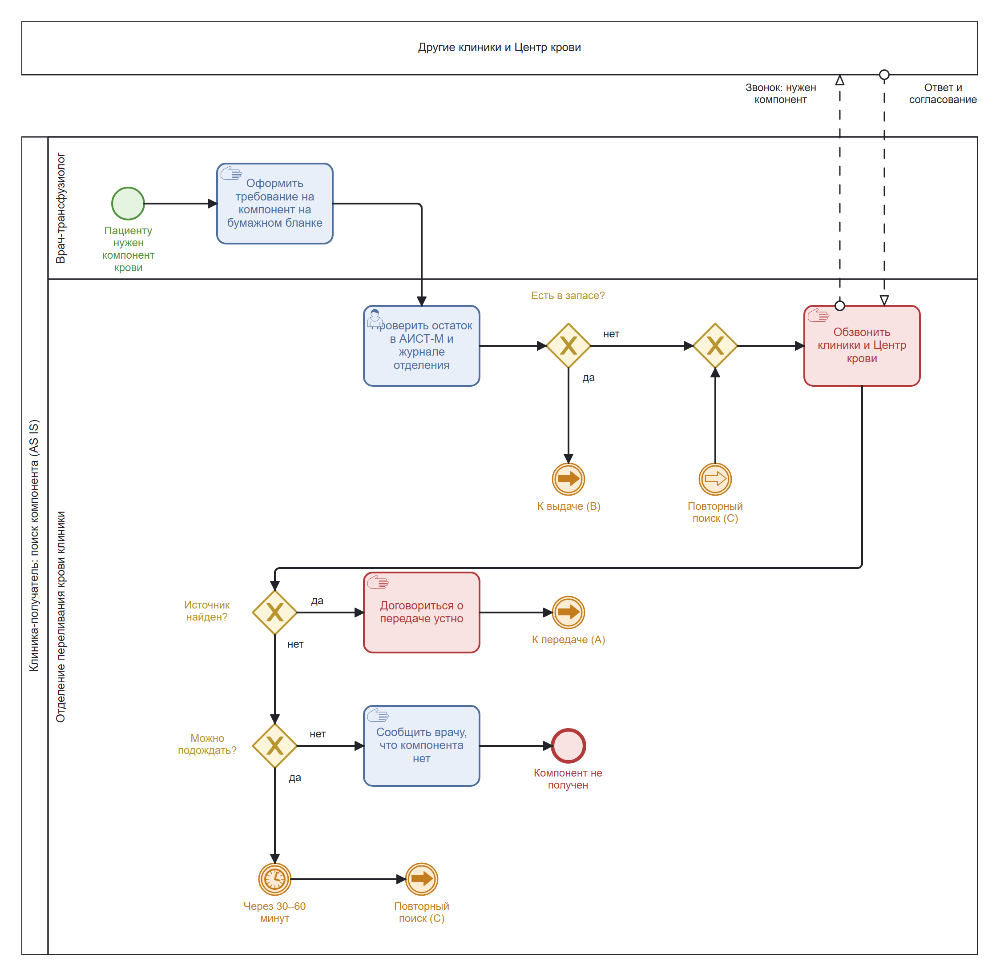
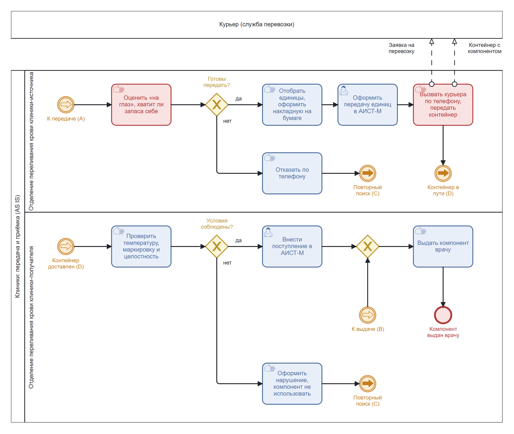
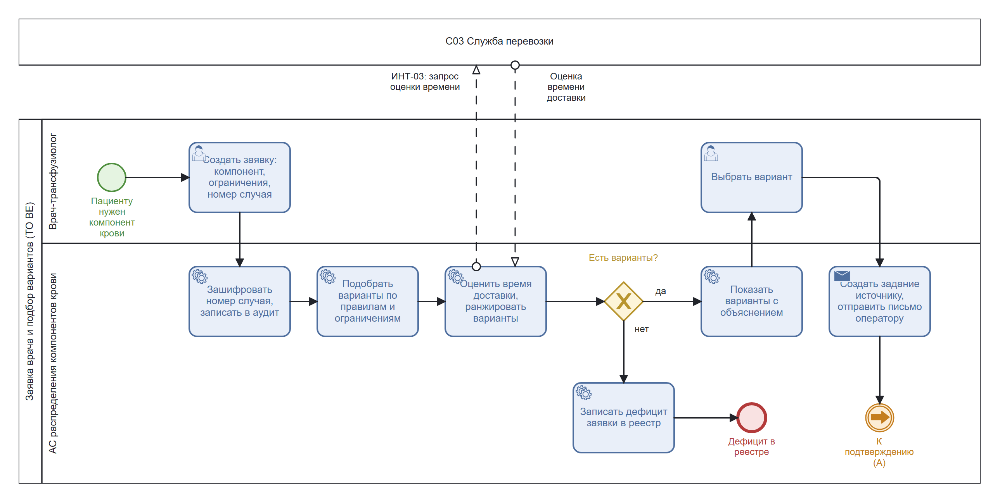
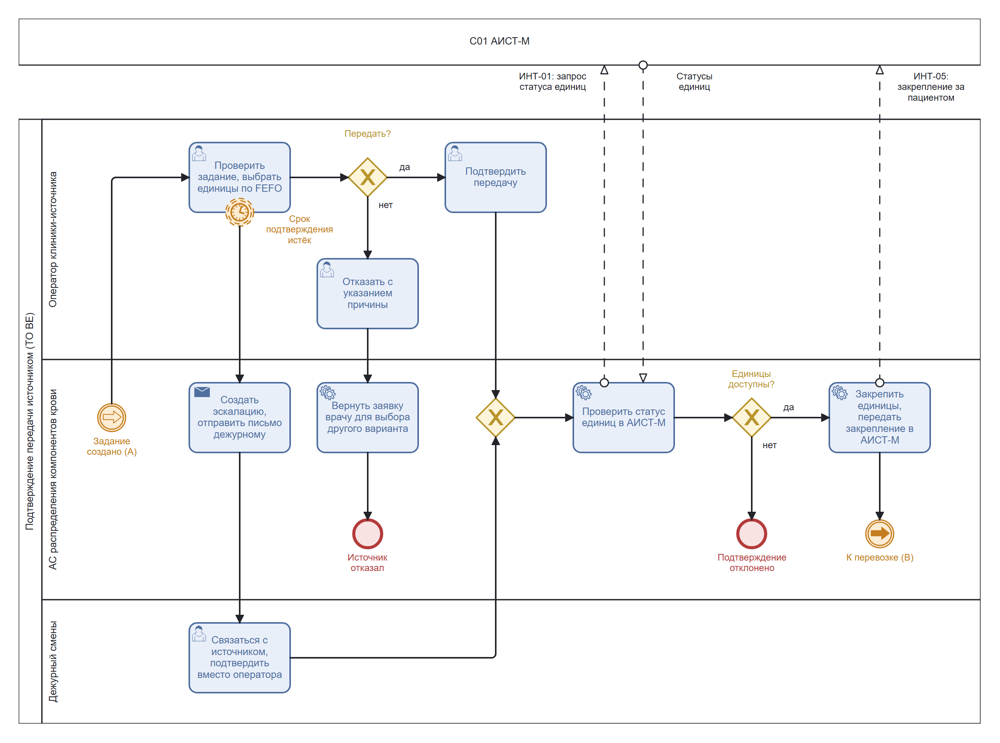
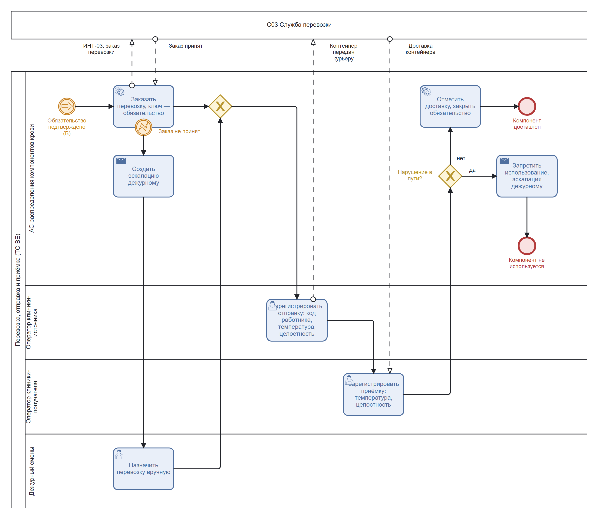
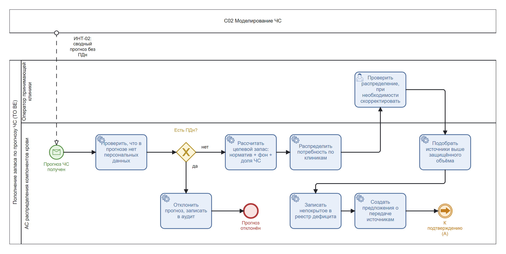

# Процесс AS IS и TO BE: обеспечение клиники компонентом крови

Бизнес-уровень: как клиника получает компонент донорской крови сейчас (AS IS) и как это происходит с АС (TO BE).
Технические схемы с дорожками сервисов лежат уровнем выше: [../README.md](../README.md).

Схемы сделаны в BPMN 2.0 с DI-разметкой и цветами (`bioc`), поэтому открываются в [Stormbpmn](https://stormbpmn.com)
(импорт файла `.bpmn`), [demo.bpmn.io](https://demo.bpmn.io) и Camunda Modeler без потери раскладки. Источник истины —
`.bpmn`; PNG рядом с ним только для показа на GitHub. После правки в Stormbpmn сохраните `.bpmn` и PNG под теми же именами.

Большой процесс разбит на части. Переходы между частями обозначены парными событиями-ссылками с буквой:
«К передаче (A)» в одной части продолжается событием «(A)» в другой.

| Цвет | Значение |
| --- | --- |
| Зелёный | Начальное событие |
| Синий | Задача |
| Красный (задача) | Узкое место AS IS: звонок, оценка «на глаз», бумага |
| Жёлтый | Шлюз (решение) |
| Оранжевый | Промежуточное событие: ссылка между частями, таймер, сбой |
| Красный (круг) | Конечное событие |

Типы задач: рука — ручная работа вне информационной системы, человек — работа в системе, шестерёнка — выполняет АС,
конверт — отправка уведомления.

## AS IS: поиск и передача по звонкам

Сейчас запас каждой клиники виден только ей самой. Если компонента нет, отделение переливания крови обзванивает
другие клиники и Центр крови, договаривается устно, а перевозку вызывает по телефону.

### Часть 1. Поиск компонента по заявке врача

Исходник: [as-is-1-search.bpmn](as-is-1-search.bpmn). Если своего запаса нет, поиск идёт по кругу «обзвон → ожидание
30–60 минут → обзвон», пока источник не найден или ждать уже нельзя.

### Часть 2. Передача и приёмка

Исходник: [as-is-2-transfer.bpmn](as-is-2-transfer.bpmn). Источник решает «на глаз», хватит ли запаса себе:
защищённого остатка нет, а при отказе поиск начинается заново (ссылка C в часть 1).

### Узкие места AS IS

| Проблема | Где на схеме | Следствие |
| --- | --- | --- |
| Остатки других клиник не видны | «Обзвонить клиники и Центр крови» | Поиск долгий, результат зависит от того, кто ответил |
| Нет правил подбора | «Договориться о передаче устно» | Замена компонента и выбор источника не объяснены и не воспроизводятся |
| Нет защищённого остатка | «Оценить „на глаз“, хватит ли запаса себе» | Источник может отдать слишком много или отказать без причины |
| Перевозка по телефону | «Вызвать курьера по телефону, передать контейнер» | Нет статуса заказа, возможны дубли и потерянные заявки |
| Нет подготовки к ЧС | весь процесс | При ЧС тот же обзвон начинается одновременно во многих клиниках |

## TO BE: распределение через АС

АС держит копию учёта АИСТ-М, подбирает варианты по правилам, не опускает источник ниже защищённого объёма,
сама заказывает перевозку и эскалирует просрочки дежурному. Клиническое решение остаётся за врачом.

### Часть 1. Заявка врача и подбор вариантов

Исходник: [to-be-1-request.bpmn](to-be-1-request.bpmn). Номер случая шифруется сразу и пишется в аудит. Если допустимых
вариантов нет, нехватка попадает в реестр дефицита, а не решается нарушением клинических ограничений
(FR029–FR035, NFR016).

### Часть 2. Подтверждение передачи источником

Исходник: [to-be-2-confirmation.bpmn](to-be-2-confirmation.bpmn). Оператор подтверждает единицы, АС проверяет их
статус в АИСТ-М и закрепляет. Таймер срока не прерывает задачу оператора: просрочка создаёт эскалацию, и дежурный
может подтвердить вместо оператора. Подробно — [сага подтверждения](../../../saga-confirmation.md).

### Часть 3. Перевозка, отправка и приёмка

Исходник: [to-be-3-transport.bpmn](to-be-3-transport.bpmn). Заказ перевозки идёт с ключом обязательства, поэтому
повтор не создаёт второй машины. Если заказ не принят, дежурный назначает перевозку вручную. Нарушение условий в пути
ставит запрет использования, который не снимается закрытием эскалации (ПП РФ № 641, п. 98).

### Часть 4. Пополнение запаса по прогнозу ЧС

Исходник: [to-be-4-emergency-plan.bpmn](to-be-4-emergency-plan.bpmn). Новый процесс, которого в AS IS нет: запас
готовится до того, как заявки начнут поступать. Прогноз с персональными данными отклоняется (NFR010), непокрытое
всегда попадает в реестр дефицита (NFR014), а предложения источникам идут в то же подтверждение, что и заявки
врачей (ссылка A в часть 2).

## Что меняется

| Шаг | AS IS | TO BE |
| --- | --- | --- |
| Поиск источника | Обзвон клиник | Подбор по копии учёта АИСТ-М всех клиник |
| Выбор компонента | Устная договорённость | Варианты по версиям правил с объяснением, выбирает врач |
| Защита источника | Оценка «на глаз» | Защищённый объём: норматив + фон + подтверждённые обязательства |
| Подтверждение | По телефону | Проверка статуса единиц в АИСТ-М и закрепление за обязательством |
| Просрочка ответа | Повторные звонки | Таймер срока и эскалация дежурному |
| Перевозка | Звонок курьеру | Заказ с ключом обязательства, статус виден в АС |
| Приёмка | Бумага и запись в АИСТ-М | Температура и целостность в АС, запрет при нарушении |
| ЧС | Тот же обзвон, массово | Пополнение заранее по прогнозу C02 |
