# ER: audit

Сгенерировано `task docs:er` из Up-миграций. Не редактировать вручную.

SHA-256 исходников: `ca58f92c93ddc00329d7af0c750446b46a3942b5d046f7f43521ace29afb7138`.

Показаны столбцы, первичные и внешние ключи. CHECK, индексы, триггеры и данные не отображаются.
Справочники и платформенные таблицы включены так же, как при запуске сервиса.
Типы с параметрами показаны без параметров; массивы сохранены.

```mermaid
erDiagram
    audit_chain_head {
        integer id PK
        bigint seq
        bytea hash
    }
    audit_local {
        bigserial id PK
        timestamptz occurred_at
        text user_id
        text role
        bigint clinic_id
        text action
        text object_type
        text object_id
        text result
        jsonb details
        text correlation_id
    }
    audit_record {
        uuid audit_record_id PK
        bigint seq
        timestamptz occurred_at
        timestamptz received_at
        text user_id
        text role
        bigint clinic_id
        text module
        text action
        text object_type
        text object_id
        text result
        jsonb details
        text correlation_id
        text producer
        uuid source_message_id
        bytea prev_hash
        bytea hash
    }
    inbox {
        uuid message_id PK
        text message_type
        timestamptz received_at
    }
    outbox {
        bigserial id PK
        uuid message_id
        text topic
        text key
        text message_type
        integer schema_version
        jsonb payload
        text correlation_id
        text causation_id
        text producer
        timestamptz occurred_at
        timestamptz published_at
    }
    ref_blood_group {
        varchar blood_group_code PK
        varchar abo_group
        boolean rh_positive
        numeric population_share
    }
    ref_clinic {
        bigint clinic_id PK
        varchar clinic_code
        varchar clinic_name
        bigint district_id FK
        boolean is_active
        boolean is_blood_center
    }
    ref_district ||--o{ ref_clinic : "district_id"
    ref_component_kind {
        varchar component_kind_code PK
        varchar component_kind_name
        boolean is_group_applicable
        bigint typical_volume_ml
        integer shelf_life_days
        boolean is_active
    }
    ref_district {
        bigint district_id PK
        varchar district_code
        varchar district_name
        bigint population
    }
    ref_unit_status {
        varchar unit_status_code PK
        varchar unit_status_name
        boolean is_available
    }
    ref_urgency {
        varchar urgency_code PK
        varchar urgency_name
        integer confirm_window_minutes
    }
    refdata_version {
        integer version PK
        timestamptz applied_at
    }
    security_incident {
        uuid incident_id PK
        text rule
        text user_id
        integer count
        integer window_seconds
        timestamptz first_seen_at
        timestamptz detected_at
        bigint audit_seq
    }
```

Исходники:

- [libs/messaging/migrations/00001_messaging.sql](../../../libs/messaging/migrations/00001_messaging.sql)
- [libs/refdata/migrations/00002_refdata.sql](../../../libs/refdata/migrations/00002_refdata.sql)
- [libs/refdata/migrations/00003_ref_unit_status.sql](../../../libs/refdata/migrations/00003_ref_unit_status.sql)
- [services/audit/migrations/00100_audit.sql](../../../services/audit/migrations/00100_audit.sql)
- [services/audit/migrations/00110_security_incident.sql](../../../services/audit/migrations/00110_security_incident.sql)
