# ER: demand

Сгенерировано `task docs:er` из Up-миграций. Не редактировать вручную.

SHA-256 исходников: `7a0cc34b93db8944ccf4bdbb5cd44c29b9ac28244970265449f36d5211604574`.

Показаны столбцы, первичные и внешние ключи. CHECK, индексы, триггеры и данные не отображаются.
Справочники и платформенные таблицы включены так же, как при запуске сервиса.
Типы с параметрами показаны без параметров; массивы сохранены.

```mermaid
erDiagram
    audit_local {
        bigserial id PK
        timestamptz occurred_at
        text user_id
        text role
        bigint clinic_id
        text action
        text object_type
        text object_id
        text result
        jsonb details
        text correlation_id
    }
    clinic_demand {
        bigint clinic_demand_id PK
        uuid demand_estimate_id FK
        bigint clinic_id FK
        varchar component_kind_code FK
        varchar blood_group_code FK
        numeric demand_volume_ml
    }
    demand_estimate ||--o{ clinic_demand : "demand_estimate_id"
    ref_clinic ||--o{ clinic_demand : "clinic_id"
    ref_component_kind ||--o{ clinic_demand : "component_kind_code"
    ref_blood_group |o--o{ clinic_demand : "blood_group_code"
    clinic_share {
        uuid clinic_share_version_id PK, FK
        bigint district_id PK, FK
        bigint clinic_id PK, FK
        numeric clinic_share
    }
    clinic_share_version ||--o{ clinic_share : "clinic_share_version_id"
    ref_district ||--o{ clinic_share : "district_id"
    ref_clinic ||--o{ clinic_share : "clinic_id"
    clinic_share_version {
        uuid clinic_share_version_id PK
        bigint version_no
        uuid statistics_file_id FK
        varchar basis
        date valid_from
    }
    statistics_file ||--o| clinic_share_version : "statistics_file_id"
    consumption_history {
        uuid consumption_history_id PK
        uuid statistics_file_id FK
        varchar history_source
        varchar component_kind_code FK
        date period_start
        date period_end
        bigint consumed_volume_ml
    }
    statistics_file |o--o{ consumption_history : "statistics_file_id"
    ref_component_kind ||--o{ consumption_history : "component_kind_code"
    demand_estimate {
        uuid demand_estimate_id PK
        bigint version_no
        date period_start
        date period_end
        uuid profile_file_id FK
        uuid clinic_share_version_id FK
        varchar estimate_status_code FK
        timestamptz calculated_at
        varchar confirmed_by
        timestamptz confirmed_at
        text rejection_reason
        text rejected_by
        timestamptz rejected_at
    }
    statistics_file ||--o{ demand_estimate : "profile_file_id"
    clinic_share_version ||--o{ demand_estimate : "clinic_share_version_id"
    estimate_status_dict ||--o{ demand_estimate : "estimate_status_code"
    district_group_share {
        uuid district_profile_id PK, FK
        varchar blood_group_code PK, FK
        numeric group_share
    }
    district_profile ||--o{ district_group_share : "district_profile_id"
    ref_blood_group ||--o{ district_group_share : "blood_group_code"
    district_profile {
        uuid district_profile_id PK
        uuid statistics_file_id FK
        bigint district_id FK
        integer population
    }
    statistics_file ||--o{ district_profile : "statistics_file_id"
    ref_district ||--o{ district_profile : "district_id"
    estimate_history_link {
        uuid demand_estimate_id PK, FK
        uuid consumption_history_id PK, FK
    }
    demand_estimate ||--o{ estimate_history_link : "demand_estimate_id"
    consumption_history ||--o{ estimate_history_link : "consumption_history_id"
    estimate_status_dict {
        varchar estimate_status_code PK
        varchar estimate_status_name
    }
    file_row_error {
        bigint file_row_error_id PK
        uuid statistics_file_id FK
        integer row_no
        text error_reason
    }
    statistics_file ||--o{ file_row_error : "statistics_file_id"
    inbox {
        uuid message_id PK
        text message_type
        timestamptz received_at
    }
    outbox {
        bigserial id PK
        uuid message_id
        text topic
        text key
        text message_type
        integer schema_version
        jsonb payload
        text correlation_id
        text causation_id
        text producer
        timestamptz occurred_at
        timestamptz published_at
    }
    ref_blood_group {
        varchar blood_group_code PK
        varchar abo_group
        boolean rh_positive
        numeric population_share
    }
    ref_clinic {
        bigint clinic_id PK
        varchar clinic_code
        varchar clinic_name
        bigint district_id FK
        boolean is_active
        boolean is_blood_center
    }
    ref_district ||--o{ ref_clinic : "district_id"
    ref_component_kind {
        varchar component_kind_code PK
        varchar component_kind_name
        boolean is_group_applicable
        bigint typical_volume_ml
        integer shelf_life_days
        boolean is_active
    }
    ref_district {
        bigint district_id PK
        varchar district_code
        varchar district_name
        bigint population
    }
    ref_unit_status {
        varchar unit_status_code PK
        varchar unit_status_name
        boolean is_available
    }
    ref_urgency {
        varchar urgency_code PK
        varchar urgency_name
        integer confirm_window_minutes
    }
    refdata_version {
        integer version PK
        timestamptz applied_at
    }
    statistics_file {
        uuid statistics_file_id PK
        varchar file_kind
        varchar file_name
        varchar file_checksum
        varchar data_source
        date period_start
        date period_end
        varchar check_status
        integer rejected_rows
        varchar uploaded_by
        timestamptz uploaded_at
    }
```

Исходники:

- [libs/messaging/migrations/00001_messaging.sql](../../../libs/messaging/migrations/00001_messaging.sql)
- [libs/refdata/migrations/00002_refdata.sql](../../../libs/refdata/migrations/00002_refdata.sql)
- [libs/refdata/migrations/00003_ref_unit_status.sql](../../../libs/refdata/migrations/00003_ref_unit_status.sql)
- [services/demand/migrations/00100_demand.sql](../../../services/demand/migrations/00100_demand.sql)
- [services/demand/migrations/00110_estimate_version.sql](../../../services/demand/migrations/00110_estimate_version.sql)
- [services/demand/migrations/00120_estimate_rejection.sql](../../../services/demand/migrations/00120_estimate_rejection.sql)
