# ER: inventory

Сгенерировано `task docs:er` из Up-миграций. Не редактировать вручную.

SHA-256 исходников: `71d8d4255589e48c149f115ef9b6da32d7abe3580e1d0eca8fd7f11afa3ff0eb`.

Показаны столбцы, первичные и внешние ключи. CHECK, индексы, триггеры и данные не отображаются.
Справочники и платформенные таблицы включены так же, как при запуске сервиса.
Типы с параметрами показаны без параметров; массивы сохранены.

```mermaid
erDiagram
    aist_outbox_message {
        bigserial id PK
        uuid idempotency_key
        uuid obligation_id
        text message_type
        jsonb payload
        timestamptz created_at
        integer attempts
        timestamptz next_attempt_at
        uuid lease_owner
        timestamptz lease_until
        timestamptz acknowledged_at
        timestamptz released_at
    }
    annual_consumption {
        uuid annual_consumption_id PK
        bigint clinic_id FK
        varchar component_kind_code FK
        smallint consumption_year
        bigint annual_volume_ml
        varchar entered_by
        timestamptz entered_at
    }
    ref_clinic ||--o{ annual_consumption : "clinic_id"
    ref_component_kind ||--o{ annual_consumption : "component_kind_code"
    audit_local {
        bigserial id PK
        timestamptz occurred_at
        text user_id
        text role
        bigint clinic_id
        text action
        text object_type
        text object_id
        text result
        jsonb details
        text correlation_id
    }
    inbox {
        uuid message_id PK
        text message_type
        timestamptz received_at
    }
    outbox {
        bigserial id PK
        uuid message_id
        text topic
        text key
        text message_type
        integer schema_version
        jsonb payload
        text correlation_id
        text causation_id
        text producer
        timestamptz occurred_at
        timestamptz published_at
    }
    planning_floor_version {
        bigint clinic_id PK
        text component_kind PK
        bigint version
    }
    ref_blood_group {
        varchar blood_group_code PK
        varchar abo_group
        boolean rh_positive
        numeric population_share
    }
    ref_clinic {
        bigint clinic_id PK
        varchar clinic_code
        varchar clinic_name
        bigint district_id FK
        boolean is_active
        boolean is_blood_center
    }
    ref_district ||--o{ ref_clinic : "district_id"
    ref_component_kind {
        varchar component_kind_code PK
        varchar component_kind_name
        boolean is_group_applicable
        bigint typical_volume_ml
        integer shelf_life_days
        boolean is_active
    }
    ref_district {
        bigint district_id PK
        varchar district_code
        varchar district_name
        bigint population
    }
    ref_unit_status {
        varchar unit_status_code PK
        varchar unit_status_name
        boolean is_available
    }
    ref_urgency {
        varchar urgency_code PK
        varchar urgency_name
        integer confirm_window_minutes
    }
    refdata_version {
        integer version PK
        timestamptz applied_at
    }
    stock_norm {
        uuid stock_norm_id PK
        uuid annual_consumption_id FK
        bigint clinic_id FK
        varchar component_kind_code FK
        numeric avg_monthly_ml
        numeric norm_ml
        boolean is_min_unit_applied
        boolean is_current
        timestamptz calculated_at
        bigint version
    }
    annual_consumption ||--o{ stock_norm : "annual_consumption_id"
    ref_clinic ||--o{ stock_norm : "clinic_id"
    ref_component_kind ||--o{ stock_norm : "component_kind_code"
    stock_norm_state {
        bigint clinic_id PK, FK
        varchar component_kind_code PK, FK
        boolean below
    }
    ref_clinic ||--o{ stock_norm_state : "clinic_id"
    ref_component_kind ||--o{ stock_norm_state : "component_kind_code"
    stock_snapshot_key {
        bigint clinic_id PK, FK
        varchar component_kind_code PK, FK
        varchar blood_group_code PK, FK
    }
    ref_clinic ||--o{ stock_snapshot_key : "clinic_id"
    ref_component_kind ||--o{ stock_snapshot_key : "component_kind_code"
    ref_blood_group ||--o{ stock_snapshot_key : "blood_group_code"
    sync_run {
        uuid sync_run_id PK
        varchar sync_kind
        varchar requested_by
        timestamptz started_at
        timestamptz finished_at
        varchar sync_result
        integer changes_count
        text error_text
        bigint source_version
        bigint clinic_id FK
        integer discrepancies_count
        bigint sync_seq
    }
    ref_clinic |o--o{ sync_run : "clinic_id"
    unit {
        uuid unit_id PK
        varchar aist_unit_code
        bigint clinic_id FK
        varchar storage_location
        varchar component_kind_code FK
        bigint volume_ml
        varchar blood_group_code FK
        varchar phenotype
        timestamptz expires_at
        varchar unit_status_code FK
        timestamptz status_received_at
        bigint source_version
    }
    ref_clinic ||--o{ unit : "clinic_id"
    ref_component_kind ||--o{ unit : "component_kind_code"
    ref_blood_group ||--o{ unit : "blood_group_code"
    ref_unit_status ||--o{ unit : "unit_status_code"
    unit_status_history {
        uuid unit_status_history_id PK
        uuid unit_id FK
        varchar unit_status_code FK
        bigint source_version
        timestamptz changed_at
        timestamptz received_at
    }
    unit ||--o{ unit_status_history : "unit_id"
    ref_unit_status ||--o{ unit_status_history : "unit_status_code"
```

Исходники:

- [libs/messaging/migrations/00001_messaging.sql](../../../libs/messaging/migrations/00001_messaging.sql)
- [libs/refdata/migrations/00002_refdata.sql](../../../libs/refdata/migrations/00002_refdata.sql)
- [libs/refdata/migrations/00003_ref_unit_status.sql](../../../libs/refdata/migrations/00003_ref_unit_status.sql)
- [services/inventory/migrations/00100_inventory.sql](../../../services/inventory/migrations/00100_inventory.sql)
- [services/inventory/migrations/00110_norm.sql](../../../services/inventory/migrations/00110_norm.sql)
- [services/inventory/migrations/00111_actual_stock.sql](../../../services/inventory/migrations/00111_actual_stock.sql)
- [services/inventory/migrations/00120_sync_run.sql](../../../services/inventory/migrations/00120_sync_run.sql)
- [services/inventory/migrations/00121_snapshot_state.sql](../../../services/inventory/migrations/00121_snapshot_state.sql)
- [services/inventory/migrations/00130_norm_state.sql](../../../services/inventory/migrations/00130_norm_state.sql)
- [services/inventory/migrations/00140_planning_floor.sql](../../../services/inventory/migrations/00140_planning_floor.sql)
- [services/inventory/migrations/00150_patient_outbox.sql](../../../services/inventory/migrations/00150_patient_outbox.sql)
