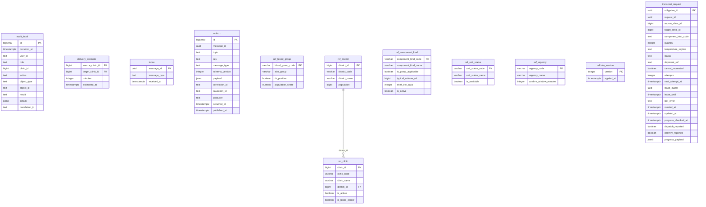

# ER: logistics-gateway

Сгенерировано `task docs:er` из Up-миграций. Не редактировать вручную.

SHA-256 исходников: `c3d9f39a2b0fd09f93847d186874de4fdef6f833665fa203a3cbe9d6645b06ea`.

Показаны столбцы, первичные и внешние ключи. CHECK, индексы, триггеры и данные не отображаются.
Справочники и платформенные таблицы включены так же, как при запуске сервиса.
Типы с параметрами показаны без параметров; массивы сохранены.

Исходники:

- [libs/messaging/migrations/00001_messaging.sql](../../../libs/messaging/migrations/00001_messaging.sql)
- [libs/refdata/migrations/00002_refdata.sql](../../../libs/refdata/migrations/00002_refdata.sql)
- [libs/refdata/migrations/00003_ref_unit_status.sql](../../../libs/refdata/migrations/00003_ref_unit_status.sql)
- [services/logistics-gateway/migrations/00100_logistics.sql](../../../services/logistics-gateway/migrations/00100_logistics.sql)
- [services/logistics-gateway/migrations/00110_transport_progress.sql](../../../services/logistics-gateway/migrations/00110_transport_progress.sql)
