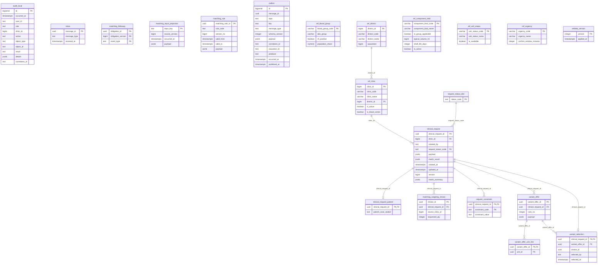

# ER: matching

Сгенерировано `task docs:er` из Up-миграций. Не редактировать вручную.

SHA-256 исходников: `2198f455f3afda10d6258bff0ccc870f359032997cec71551a00c7d84cf89610`.

Показаны столбцы, первичные и внешние ключи. CHECK, индексы, триггеры и данные не отображаются.
Справочники и платформенные таблицы включены так же, как при запуске сервиса.
Типы с параметрами показаны без параметров; массивы сохранены.

Исходники:

- [libs/messaging/migrations/00001_messaging.sql](../../../libs/messaging/migrations/00001_messaging.sql)
- [libs/refdata/migrations/00002_refdata.sql](../../../libs/refdata/migrations/00002_refdata.sql)
- [libs/refdata/migrations/00003_ref_unit_status.sql](../../../libs/refdata/migrations/00003_ref_unit_status.sql)
- [services/matching/migrations/00100_init.sql](../../../services/matching/migrations/00100_init.sql)
- [services/matching/migrations/00110_matching.sql](../../../services/matching/migrations/00110_matching.sql)
- [services/matching/migrations/00120_request_projection_index.sql](../../../services/matching/migrations/00120_request_projection_index.sql)
- [services/matching/migrations/00130_followup.sql](../../../services/matching/migrations/00130_followup.sql)
- [services/matching/migrations/00140_outgoing_choice.sql](../../../services/matching/migrations/00140_outgoing_choice.sql)
- [services/matching/migrations/00150_cancellation_result.sql](../../../services/matching/migrations/00150_cancellation_result.sql)
- [services/matching/migrations/00160_request_summary.sql](../../../services/matching/migrations/00160_request_summary.sql)
