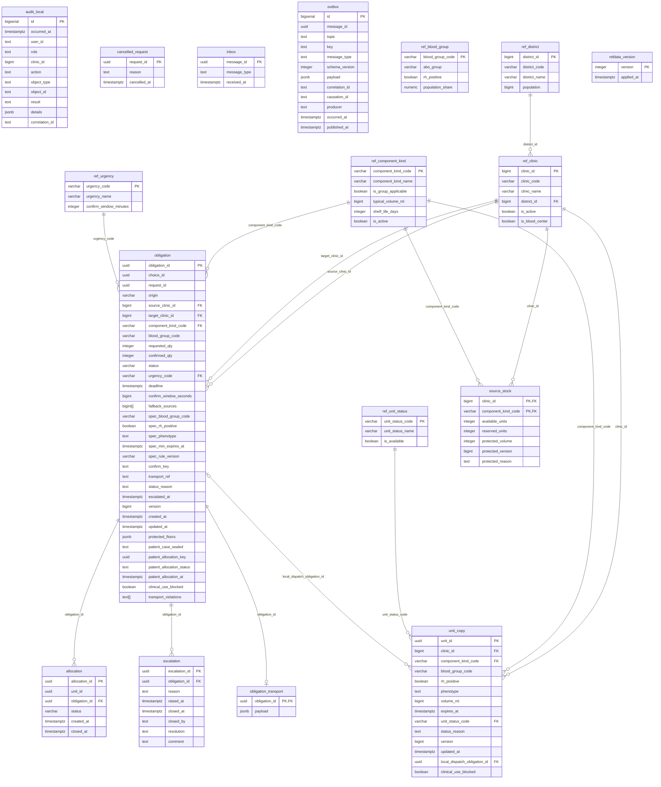

# ER: transfer

Сгенерировано `task docs:er` из Up-миграций. Не редактировать вручную.

SHA-256 исходников: `d28d11fe6a106a87aecbbf6e6cf2995a3867fd20ee661cd13de6e6663efc80b8`.

Показаны столбцы, первичные и внешние ключи. CHECK, индексы, триггеры и данные не отображаются.
Справочники и платформенные таблицы включены так же, как при запуске сервиса.
Типы с параметрами показаны без параметров; массивы сохранены.

Исходники:

- [libs/messaging/migrations/00001_messaging.sql](../../../libs/messaging/migrations/00001_messaging.sql)
- [libs/refdata/migrations/00002_refdata.sql](../../../libs/refdata/migrations/00002_refdata.sql)
- [libs/refdata/migrations/00003_ref_unit_status.sql](../../../libs/refdata/migrations/00003_ref_unit_status.sql)
- [services/transfer/migrations/00100_transfer.sql](../../../services/transfer/migrations/00100_transfer.sql)
- [services/transfer/migrations/00110_protected_floors.sql](../../../services/transfer/migrations/00110_protected_floors.sql)
- [services/transfer/migrations/00120_cancelled_request.sql](../../../services/transfer/migrations/00120_cancelled_request.sql)
- [services/transfer/migrations/00130_patient_case.sql](../../../services/transfer/migrations/00130_patient_case.sql)
- [services/transfer/migrations/00150_transport_and_escalation.sql](../../../services/transfer/migrations/00150_transport_and_escalation.sql)
