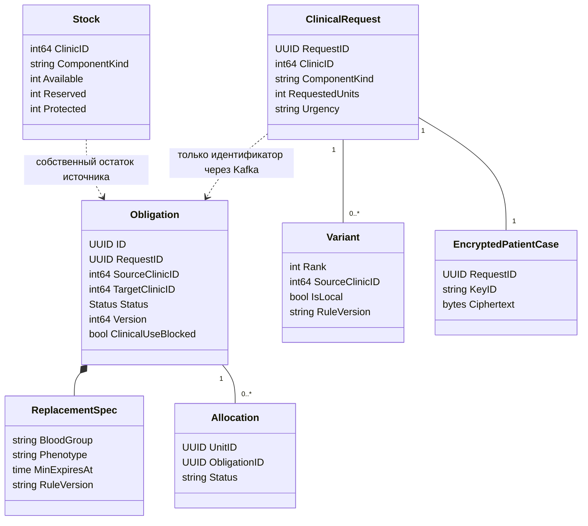
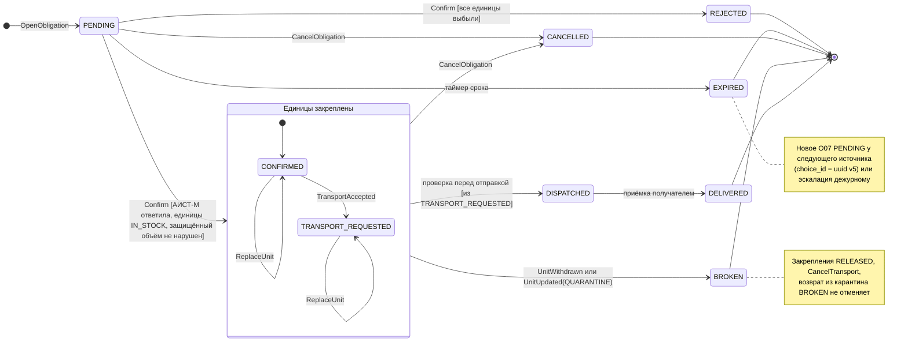
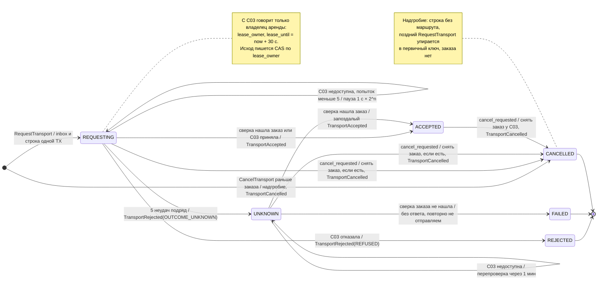
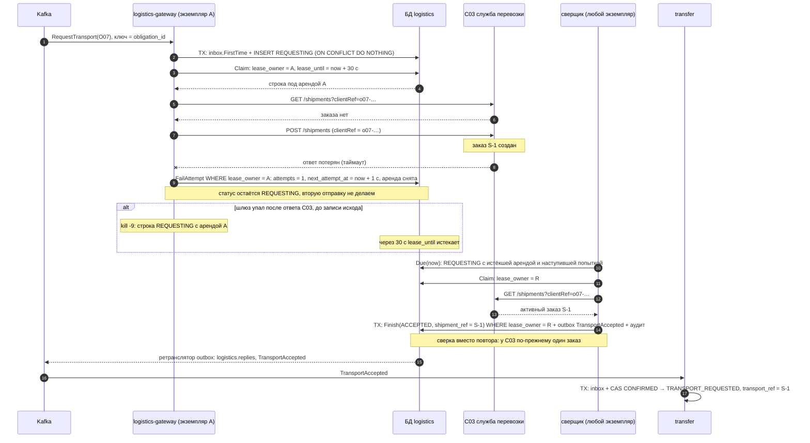

# UML: состояния O07 и заказа перевозки, сверка шлюза

Диаграммы в Mermaid. Спецификация переходов O07 — канон [obligation-states.md](../domain/obligation-states.md),
отступления этапа 1 — [ADR-0027](../adr/0027-stage1-deviations.md); при расхождении верен канон, а не эта страница.
Последовательности основного пути саги и компенсаций — [saga-confirmation.md](saga-confirmation.md), процесс целиком —
BPMN [confirm-transfer.bpmn](diagrams/bpmn/confirm-transfer.bpmn).

## Агрегаты передачи и заявки

`Obligation`, закрепления и остаток хранятся в transfer; заявка, варианты и зашифрованный номер — в matching.
Связь между базами логическая, без внешнего ключа. Номер случая раскрывается отдельной операцией после аудита.

## Состояния обязательства O07

Переходы те же, что в каноне; закрепляющие состояния собраны в составное «Единицы закреплены», потому что выход из
обоих одинаков: выбытие или карантин закреплённой единицы и отмена.

Повтор `Confirm` с тем же ключом в `CONFIRMED` или `TRANSPORT_REQUESTED` состояния не меняет и возвращает прежний
`Confirmed`. Отказ перевозчика (`TransportRejected`) тоже не меняет состояния: O07 остаётся `CONFIRMED`, дежурному уходит
эскалация. `DISPATCHED` и `DELIVERED` реализуются на этапе 7 (ADR-0022).

| Переход | Условие | Действия в той же транзакции |
| --- | --- | --- |
| `PENDING → CONFIRMED` | Точечный статус АИСТ-М получен до транзакции; под блокировкой Остатка копия перепроверена; `free − k ≥ protected_volume` | `allocation` × k (`UNIQUE (unit_id) WHERE status = 'CONFIRMED'`), `reserved += k`, outbox: `TransferConfirmed`, [`TransferShortfallRecorded`], `RequestTransport`; аудит |
| `PENDING → REJECTED` | Все единицы выбыли по ответу АИСТ-М | `TransferRejected(UNITS_WITHDRAWN)`; аудит |
| `PENDING → EXPIRED` | Срок вышел, опрос каждые 5 с | Новое O07 и `TransferExpired(next_obligation_id)` или `TransferExpired` и `EscalationRaised(EXPIRED_NO_FALLBACK)`; аудит |
| `PENDING → CANCELLED` | `CancelObligation` или отмена через API | `TransferCancelled`; аудит |
| `CONFIRMED → TRANSPORT_REQUESTED` | `TransportAccepted` из inbox | `transport_ref`, `TransportRequested` |
| `CONFIRMED`, `TRANSPORT_REQUESTED` → `BROKEN` | Закреплённая единица выбыла или ушла на карантин | Закрепления `RELEASED`, `reserved −= k`, `TransferBroken(reason)`, `CancelTransport(UNIT_WITHDRAWN \| UNIT_QUARANTINED)`; аудит |
| `CONFIRMED`, `TRANSPORT_REQUESTED` → `CANCELLED` | `CancelObligation` или отмена через API | Закрепления `RELEASED`, резерв снят, `TransferCancelled`, `CancelTransport(OBLIGATION_CANCELLED)`; аудит |
| `CONFIRMED`, `TRANSPORT_REQUESTED` → то же | `ReplaceUnit` по спецификации замены (ADR-0011) | `casTouch`, старое закрепление `RELEASED`, новое `CONFIRMED`, `TransferUnitReplaced`; резерв и заказ перевозки не меняются |

Каждый переход — `UPDATE … WHERE status = :expected` (CAS): из одновременных событий (оператор, таймер, отмена, ответ
шлюза) выигрывает одно.

## Состояния заказа перевозки (transport_request)

Строка `transport_request` в базе `logistics`, одна на обязательство (первичный ключ `obligation_id`).

| Правило | Как держится |
| --- | --- |
| Один заказ на обязательство | Первичный ключ `obligation_id`; inbox отсекает повтор доставки; сверка по `clientRef = o07-<id>` всегда раньше отправки |
| Один исполнитель на строку | Аренда: `Claim` берёт строку, только если `lease_until` истёк; при `kill -9` аренда истекает сама, и строку подбирает сверщик |
| Исход опоздавшего не применяется | `Finish` и `FailAttempt` — `UPDATE … WHERE lease_owner = :owner` |
| Очередь сверщика | Частичный индекс по `next_attempt_at` для `REQUESTING`, `UNKNOWN` и `ACCEPTED` с `cancel_requested` |
| Отмена конечного заказа | `CancelTransport` при `REJECTED` или `FAILED` ставит флаг и сразу отвечает `TransportCancelled`: снимать у перевозчика нечего, статус не меняется |

## Сверка шлюза при потерянном ответе C03

Перевозчик принял заказ, но ответ до шлюза не дошёл. Повтор вслепую создал бы вторую машину: перевозчик заказы не
дедуплицирует. Сценарий из теста `lostResponseIsReconciledInsteadOfResubmitted`; так же завершается падение шлюза после
ответа C03 до записи исхода (`crashAfterC03AcceptedButBeforeRecordingTheOutcome`).

Если C03 не отвечает дольше пяти попыток, строка переходит в `UNKNOWN`, transfer получает
`TransportRejected(OUTCOME_UNKNOWN)` и эскалирует дежурному, а сверщик продолжает раз в минуту: найденный заказ даёт
запоздалый `TransportAccepted`, ненайденный — `FAILED` без повторной отправки (дежурный мог заказать машину сам).
