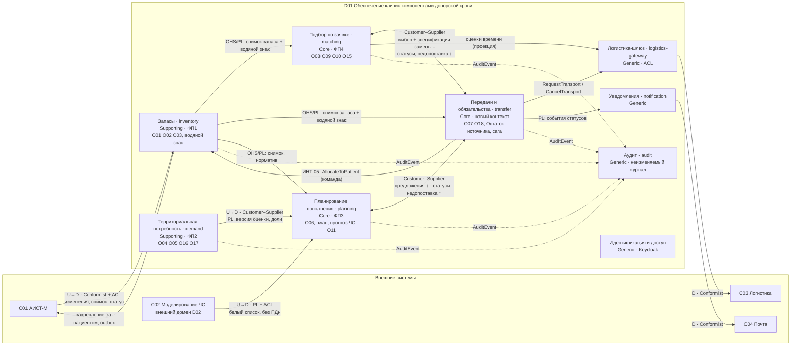

# Карта ограниченных контекстов (целевая)

Источник: схема 10 «Карта контекстов (целевая)» из плана миграции, уточнена под Go-реализацию.

Обозначения: U — upstream, D — downstream; OHS/PL — открытый сервис и опубликованный язык; ACL — антикоррупционный слой.

## Отношения и что они значат для кода

| Отношение | Тип | Правило |
| --- | --- | --- |
| C01 → inventory | Conformist + ACL | Формат АИСТ-М не выходит за пределы `inventory/internal/adapters/aist`. Внутрь публикуются только события `UnitRegistered`, `UnitUpdated`, `UnitWithdrawn`, `StockSnapshotPublished` |
| inventory → transfer, matching, planning | OHS / PL | Снимок запаса и единицы с версией (водяной знак). Потребители держат проекцию и показывают «данные на …». Деградация при задержке, а не зависание |
| transfer → inventory | единственный синхронный вызов | `GET /internal/units/status?ids=` перед транзакцией подтверждения (ADR-0004) |
| demand → planning | Customer–Supplier, PL | `DemandEstimatePublished` с версией и строками `clinic_demand`; planning строит план только по опубликованной версии |
| matching ↔ transfer | Customer–Supplier | matching шлёт команду `OpenObligation` (выбор врача, спецификация замены, fallback-источники); transfer отвечает событиями статусов и `TransferShortfallRecorded`; matching реагирует подбором следующего варианта или дефицитом |
| planning ↔ transfer | Customer–Supplier | planning шлёт `OpenObligation` по предложениям плана; читает статусы и недопоставки, пересчитывает покрытие |
| C02 → planning | PL + ACL | Входной фильтр: белый список полей, отбрасывание всего остального; версия сценария уникальна |
| transfer → logistics-gateway → C03 | ACL | Команды и ответы через Kafka; шлюз держит сверку, аренду, кэш оценок времени |
| transfer → notification → C04 | PL | notification подписан на `transfer.events`; сбой письма не отменяет задание (FR044) |
| все → audit | PL | Каждый сервис пишет `AuditRecorded` в свой outbox; audit строит цепочку хешей |
| Keycloak | Generic | Роль и `clinic_id` в токене; сервисы проверяют JWT по JWKS |

## Что принадлежит кому (владение данными)

| Данные | Владелец | Кто держит копию |
| --- | --- | --- |
| Единицы, статусы, норматив, годовой расход, SyncRun | inventory | transfer (`unit_copy`, `source_stock`), matching (`unit_projection`), planning (`stock_projection`) |
| Файлы CSV, профили, история расхода, доли, версии оценки | demand | planning (`demand_projection` по опубликованной версии) |
| Прогноз ЧС, целевой запас, план, предложения, реестр дефицита | planning | — (matching шлёт `RequestDeficitRecorded`, planning проецирует в O11) |
| Заявки, ограничения, правила O15, варианты, выбор | matching | — |
| Обязательства, закрепления, Остаток источника | transfer | matching/planning (`obligation_status_projection`) |
| Заказы перевозки, оценки времени | logistics-gateway | matching, planning (`delivery_estimate_projection`) |
| Справочники (клиники, районы, виды, группы, срочность) | `libs/refdata` (статический набор, одинаковый для всех), в проде — событие `ReferenceDataChanged` | каждый сервис в своей БД |
| Учётные записи и роли | Keycloak | — |
| Журнал аудита | audit | — |
