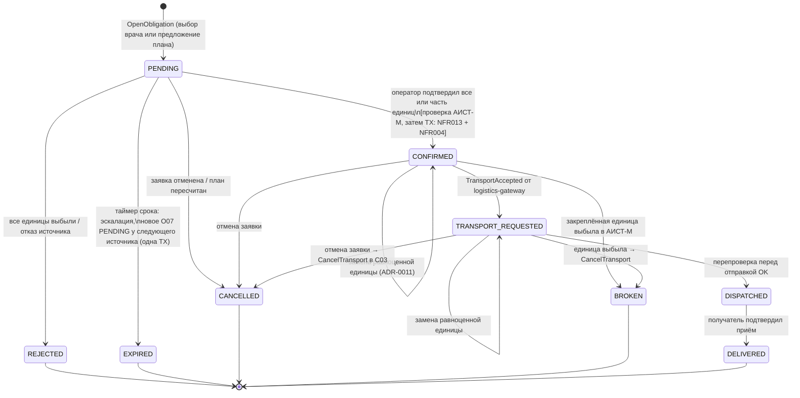

# Состояния обязательства O07 и сага подтверждения

Источник: схема 13 «Состояния обязательства O07», схема 12 «Сага подтверждения передачи», Java-прототип `TransferService`.
Это спецификация агрегата `transfer.obligation`. Менять без ADR нельзя.

## Состояния



| Статус | Смысл | Держит закрепления | Конечный |
| --- | --- | --- | --- |
| `PENDING` | Ожидает подтверждения оператором источника; срок = `confirm_window` по срочности (минуты для экстренной) | нет | нет |
| `CONFIRMED` | Подтверждено, единицы закреплены (O18 ACTIVE), команда `RequestTransport` в outbox | да | нет |
| `TRANSPORT_REQUESTED` | C03 принял заказ, `transport_ref` записан | да | нет |
| `DISPATCHED` | Отправлено курьером; закрепления → CONSUMED | — | нет |
| `DELIVERED` | Доставлено, принято клиникой | — | да |
| `REJECTED` | Отклонено: все единицы выбыли или источник отказал; подбор предложит следующий вариант | нет | да |
| `EXPIRED` | Не подтверждено в срок; эскалация дежурному; новое O07 у следующего источника | нет | да |
| `CANCELLED` | Отменено (заявка отменена, план пересчитан); закрепления сняты; после TRANSPORT_REQUESTED ушёл `CancelTransport` | нет | да |
| `BROKEN` | Нарушено: закреплённая единица выбыла в АИСТ-М после подтверждения; закрепления сняты, `CancelTransport`; дефицит заявки | нет | да |

Статус «ожидает подтверждения АИСТ-М» из ПР6 (FR051, FR052) реализуется **не** отдельным состоянием O07, а полем
`aist_ack_at` и статусом сообщения в `inventory.aist_outbox_message`: O07 остаётся `CONFIRMED`, UI показывает
«закрепление передаётся в АИСТ-М» до квитанции. Причина: состояние принадлежит другому контексту (ADR-0003).

Частичное подтверждение — не состояние: `confirmed_qty < requested_qty`, на недостачу событие `TransferShortfallRecorded`.

## Правила переходов

1. Каждый переход — `UPDATE obligation SET status = :new, version = version + 1 WHERE id = :id AND status = :expected` (CAS).
   Из одновременных событий (оператор, таймер, отмена, ответ шлюза) выигрывает одно.
2. Порядок блокировок всегда одинаковый: строка `source_stock` (клиника × вид), затем строка `obligation`.
   Обработчик ответов логистики блокирует только `obligation`.
3. Проверка статуса единиц в АИСТ-М (через `inventory`) идёт **синхронно до транзакции**, вне блокировки, таймаут 3 с.
   Хранимого состояния «проверяется» нет: оператор получает ответ в том же HTTP-запросе.
4. Повтор подтверждения с тем же `idempotency_key` при статусе `CONFIRMED` возвращает тот же результат `Confirmed`.
5. После `DISPATCHED` отмена уже не компенсация: возврат единицы решает ОПК, автоматически свободной она не становится.

## Подтверждение: порядок шагов (`ConfirmTransfer`)

```
1. find O07; нет → InvalidRequest. status ≠ PENDING → CONFIRMED с тем же ключом ? Confirmed : TaskWithdrawn(status)
2. validate: непустой список разных единиц, не больше requested_qty, все единицы источника и того же вида
3. statuses = inventory.CheckUnits(ids)          // единственный синхронный вызов; SourceSystemUnavailable → ответ «повторите»
4. present / withdrawn разделить
   все выбыли              → TX: CAS PENDING→REJECTED, событие TransferRejected, аудит → Rejected
   часть выбыла, !partial  → UnitsUnavailable(withdrawn), состояние не менялось
5. TX:
   lock source_stock(source_clinic, kind)
   перепроверить копию: withdrawnMeanwhile → убрать; если !partial или пусто → UnitsUnavailable
   k = len(present); if stock.free - k < stock.protected_volume → ProtectedVolumeExceeded(maxConfirmable)
   CAS PENDING→CONFIRMED (confirmed_qty = k, confirm_key) ; fail → TaskWithdrawn
   INSERT allocation(unit, O07, CONFIRMED) × k   // UNIQUE (unit_id) WHERE status='CONFIRMED' → UnitsTaken
   source_stock.reserved += k
   outbox: TransferConfirmed, [TransferShortfallRecorded], command RequestTransport(key = O07 id)
   audit CONFIRMED
6. ответ Confirmed(units, shortfall) в том же запросе
```

Результаты (`ConfirmationResult`): `Confirmed`, `TaskWithdrawn`, `UnitsUnavailable`, `Rejected`, `UnitsTaken`,
`ProtectedVolumeExceeded`, `InvalidRequest`, `SourceSystemUnavailable`.

## Замена единицы (`ReplaceUnit`, ADR-0011)

Разрешена в `CONFIRMED` и `TRANSPORT_REQUESTED`. Кандидат проверяется по спецификации замены (источник, вид, группа,
резус, фенотип, годность на момент прибытия), по копии и точечным запросом в АИСТ-М. В одной транзакции: lock Остатка,
`casTouch` O07, старое закрепление → `RELEASED`, новое `CONFIRMED` (уникальный индекс → `UnitTaken`), резерв не меняется,
событие `TransferUnitReplaced`. Команда перевозчику не меняется: номеров единиц в `RequestTransport` нет.
Результаты: `Replaced`, `NotAllowed(status)`, `SpecMismatch`, `UnitUnavailable`, `UnitTaken`, `SourceSystemUnavailable`.

## Таймер срока (`ExpireOverdue`)

Долговечный таймер в БД `transfer` (индекс по `deadline WHERE status = 'PENDING'`), опрос каждые 5 с. Для каждого
просроченного в одной транзакции: CAS `PENDING→EXPIRED`, событие `TransferExpired`, аудит «эскалация дежурному»,
если есть `fallback_sources` — новое O07 `PENDING` у следующего источника с `choice_id = uuid5("escalation:" + old id)`
и хвостом источников. Позднее подтверждение первого источника проигрывает CAS: две отправки невозможны.

## Компенсации

| Событие | Реакция `transfer` |
| --- | --- |
| `UnitWithdrawn` из `inventory` для закреплённой единицы | Сразу, в одной транзакции: CAS → `BROKEN`, все закрепления O07 → `RELEASED`, резерв уменьшается, в outbox `TransferBroken`, `CancelTransport` (шлётся всегда: шлюз отвечает и тогда, когда заказа не было), аудит. Решение владельца от 23.10.2026, как в Java-прототипе (`InventoryProjection`). Замену равноценной единицей оператор делает только **до** выбытия, через `ReplaceUnit` |
| `TransportRejected(REFUSED)` | O07 остаётся `CONFIRMED`, событие `TransportRequestFailed`, эскалация дежурному: перевозку организует вручную |
| `TransportRejected(OUTCOME_UNKNOWN)` | O07 остаётся `CONFIRMED`; если сверка шлюза позже найдёт заказ, придёт запоздалый `TransportAccepted` |
| `TransportAccepted` для не-`CONFIRMED` O07 | Игнорируется с записью в аудит: `CancelTransport` уже ушла в момент нарушения |
| `CancelObligation` от `matching`/`planning` | `PENDING`/`CONFIRMED` → `CANCELLED`, закрепления `RELEASED`, резерв снят; после `TRANSPORT_REQUESTED` ещё `CancelTransport` |

## Четыре гонки (обязательные фитнес-тесты)

1. **Защищённый объём**: два оператора подтверждают из одного Остатка, вместе опускают ниже защищённого объёма → проходит ровно одно, второе `ProtectedVolumeExceeded`.
2. **Выдача во время подтверждения**: `UnitWithdrawn` приходит между проверкой АИСТ-М и транзакцией → перепроверка под блокировкой ловит, `UnitsUnavailable` или частичное.
3. **Позднее подтверждение после эскалации**: таймер перевёл в `EXPIRED` и открыл новое O07; подтверждение старого → `TaskWithdrawn(EXPIRED)`; единицы не закреплены дважды.
4. **Замена против подтверждения**: одна и та же единица одновременно — кандидат замены в O07-A и подтверждение в O07-B → уникальный индекс пускает одного, второй `UnitTaken`.

Плюс: 50 параллельных подтверждений одной единицы разными обязательствами → ровно одно `Confirmed` (NFR004).
